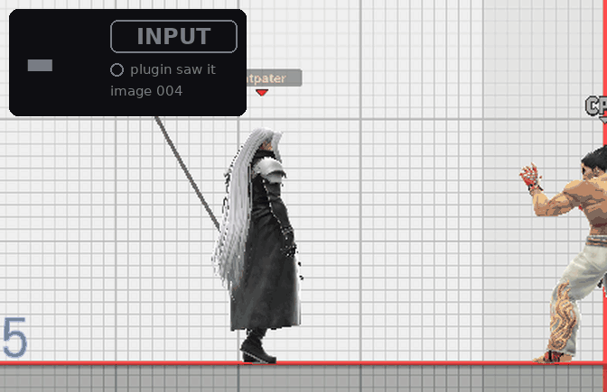
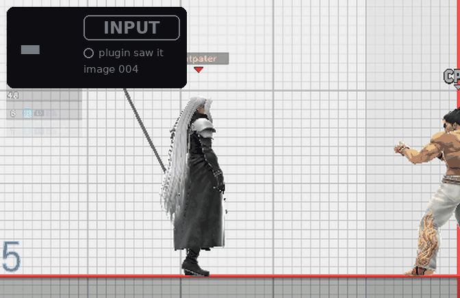
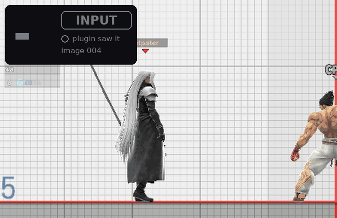

# Online Deluxe rewrite

> **Disclaimer:** this project was developed with the assistance of AI
> (Claude, Codex and other coding agents) under the operator's direction and
> review. Every build recorded here was tested as described in
> [validation](docs/VALIDATION.md); nothing is claimed beyond those records.

A Rust/Skyline reconstruction of Online Deluxe for **Super Smash Bros. Ultimate 13.0.5**,
delivered as **one NRO**: rendering profiles that cut input latency, a global
Player Info window, the native character-select status line and network
display. No overclocking.

**Current release: 0.5.1.** It adds the render-opts teardown guard, which
removes a crash at scene exits with render options active (Training →
character select on the console). 0.5.0 moved character FX out to the separate
[FX Control](https://git.syntaxbyexample.com/intpa/ssbu-fx-control) plugin and
lets plugins add their own pages to the window cycle. Every release on Forgejo
carries the NRO and its manifest. Install notes: [docs/INSTALL.md](docs/INSTALL.md).

> **Install only this NRO.** The rewrite replaces the original Online Deluxe
> fork (`libssbu_online_deluxe*.nro`), SsbuSync (`libssbusync.nro`) and the
> PIA manager (`libssbu_pia_manager.nro`). Remove those three; do not run them
> next to `libssbu_online_deluxe_rewrite.nro`. The two do not stack: when
> SsbuSync is loaded, Deluxe switches every one of its hooks off, logs
> `Existing SsbuSync host detected; rewrite hooks skipped` (event code 16, `a` = 1),
> and you are playing the old fork without noticing. The fork's other
> companions, `libnx_over.nro` and `libsmashline_plugin.nro`, are not needed by
> Deluxe either; keep them only if another mod needs them.
> [What to remove, what to keep](docs/INSTALL.md#what-to-remove-what-to-keep).


| | |
| --- | --- |
|  <br> The Settings view in menus. |  <br> The native status line on the character select. |
|  <br> In a match the window becomes a compact two-row strip at the top left. |  <br> After a match the manual profile is held at Vanilla and the line reads `Vanilla*`. |

More in [Screenshots](docs/SCREENSHOTS.md).

## What it does

- **Rendering profiles.** Vanilla, LessLag, LLUltra and LLDoubles trade
  buffered frames for latency; Auto picks one from the scene. Since 0.4.0
  two-image LessLag presents at the flush, which removed the character-select
  stall on the console (49.9 → 59.85 fps on the hand sweep). [Rendering profiles](docs/RENDERING.md)
- **Player Info window and native status.** Settings, Performance, Debug and
  Plugins views on L+R+Down; the character select keeps your profile, buffer
  and the opponent's settings and RTT at the top. [Controls](docs/CONTROLS.md),
  [native display](docs/NATIVE_DISPLAY.md)
- **Network display.** Opponent name, interface, settings and colored RTT from
  the game's own measurement; Stealth and Streamer switches. [Controls](docs/CONTROLS.md)
- **Character FX moved out.** Since 0.5.0 the On, Off and Reduced character
  effects are the separate, optional plugin
  [`intpa/ssbu-fx-control`](https://git.syntaxbyexample.com/intpa/ssbu-fx-control)
  on Forgejo. Installed next to Deluxe, it adds an FX Control page to the
  window cycle and uses Deluxe's online tracking. Deluxe itself has no effect hooks.
- **Dispatcher backoff.** One inline hook that lets the game's idle dispatcher
  sleep instead of spinning. [Dispatcher backoff](docs/DISPATCHER_BACKOFF.md)
- **Plugins page and own pages.** Other mods register rows through an exported
  API and the Rust SDK, on the shared Plugins page or, since 0.5.0, on a page
  of their own. [Plugins](docs/PLUGINS.md), [`sdk/`](sdk/README.md)
- **Captures.** Opt-in 30 s character-select captures and whole-match captures
  streamed to the card for frame analysis. [Captures](docs/CAPTURES.md)

## Controls

Hold **L+R** (or **ZL+ZR**) and tap **D-pad Down** to cycle the window:
settings → plugins (when any registered) → own plugin pages, such as FX
Control when that plugin is installed → performance → hidden. In the window
**Up/Down** selects a row and **Left/Right** changes it. L+R and **Plus** opens
the Debug view. Everything else, including the ZL-gated native edits on the
character select, is in [Controls](docs/CONTROLS.md).

## Rendering profiles

| Profile | Textures | Presentation | Console | Emulator |
| --- | --- | --- | --- | --- |
| Vanilla | 3 | TwoBehind | 1080p, DRS off | 1080p, DRS off |
| LessLag | 2 | OneBehind, presents at the flush | 1080p, DRS on | 1080p, DRS off |
| LLUltra | 2 | Immediate, earlier flush, presents at the flush (0.5.2) | 576p, DRS on | 1080p, DRS off |
| LLDoubles | 3 | OneBehind, presents at the flush (0.5.2) | 1080p, DRS on | 1080p, DRS on |

Auto uses Vanilla in menus, offline matches and Training; online singles get
LessLag on console or LLUltra on emulator; online matches with more than two
fighters get LLDoubles. How Auto recognises an online match, the cleanup hold
(`Vanilla*`) and DRS are in [Rendering profiles](docs/RENDERING.md).

### Measured input delay

Captured-response trials in Eden: frames from a synthetic input to the first
visible response, three trials per cell, at two injection phases. The earlier
columns are build `b19b7d94ae136e55`; the 0.5.2 columns are the 0.5.2
NRO `1525e3e0` (build `0.5.2-ce0145a2155c`), measured on 2026-10-15
with the same method, after LLUltra and LLDoubles started presenting at the
flush as LessLag does.

| Profile | Normal phase (b19) | Later phase (b19) | Normal phase (0.5.2) | Later phase (0.5.2) | Frames saved vs Vanilla (0.5.2) |
| --- | --- | --- | --- | --- | --- |
| Vanilla | 6, 6, 6 | 6, 6, 6 | 6, 6, 6 | 6, 6, 6 | — |
| LessLag | 3, 3, 3 | 3, 3, 3 | 3, 3, 3 | 3, 3, 3 | **3** |
| LLUltra | 2, 2, 2 | 3, 2, 3 | 2, 2, 2 | 2, 3, 3 | **4** normal, **3–4** later |
| LLDoubles | 4, 4, 4 | 4, 4, 4 | 4, 4, 4 | 4, 4, 5 | **2** normal, **1–2** later |

On 0.5.2 LLUltra still shows one captured frame fewer than LessLag when the
input lands at the normal phase (2 against 3 in all three trials). At the later
phase the two are within a frame: LLUltra 2, 3, 3 against LessLag 3, 3, 3, and
the one 2 is in a trial whose API trace was not captured. Present-at-flush
did not change the captured-image counts of any profile; its purpose is the
console frame-time stall, which these trials do not measure. Seven of the 24
0.5.2 trials (all in the later phase) are not covered by their API trace
export and rest on the in-game marker's consecutive present identities alone.

Each frame below is a real 640×360 capture from one included trial (normal
phase, trial 1), played at about three frames per second. The number counts
captured frames from the first image after the stick-down was injected up to
the first image showing the crouch (green); INPUT lights from that first image,
and the small "plugin saw it" lamp lights when the in-game input marker first
shows the Down bit.

| Vanilla: 6 frames | LessLag: 3 frames | LLUltra: 2 frames |
| --- | --- | --- |
|  |  |  |

LLDoubles was measured as a manual profile in two-fighter Training. These are
emulator screenshots with synthetic input, not Switch input-to-photon
measurements. The b19 columns predate 0.4.0's present-at-flush change to
LessLag, which removed the console's character-select stall (49.9 → 59.85 fps
on the hand sweep) without changing the frame count claim; the 0.5.0 release
NRO re-measured on 2026-10-15 gave Vanilla 6, LessLag 3, LLUltra 2 (normal) and
2–3 (delayed), and 0.5.2 gives the same counts. Method and every result set:
[LATENCY_METHODOLOGY.md](docs/LATENCY_METHODOLOGY.md); original full results:
[PERFORMANCE.md](docs/PERFORMANCE.md).
## Configuration

`sd:/ultimate/ssbu_online_deluxe_rewrite/config.ini`, created with defaults on
first boot; menu edits are saved automatically. Keys, boot flags and the Eden
overrides are in [Configuration](docs/CONFIGURATION.md).

## Diagnostics

Logs live under `sd:/ultimate/ssbu_online_deluxe_rewrite/` (`install.log`,
`events.log`, `hang-trace.log`, `renderer-status.txt`, `panic.log`). Keep the
exact NRO and its debug bundle when reporting a crash. Event codes, log
formats, bisection flags and the Eden test lifecycle are in
[Debugging](docs/DEBUGGING.md).

## Build

```powershell
cargo clippy --all-targets -- -D warnings
cargo build --no-default-features
cargo test
cargo skyline clippy -- -- -D warnings
/usr/bin/pwsh -NoLogo -NoProfile -NonInteractive -Command '& ./tools/Build.ps1 -Package'
```

Toolchain, native dependency and release steps: [Build](docs/BUILD.md).

## Documentation

| Topic | Document |
| --- | --- |
| Install, coexistence with other plugins, rollback | [INSTALL.md](docs/INSTALL.md) |
| Controls and the settings rows | [CONTROLS.md](docs/CONTROLS.md) |
| Screenshots and GIFs | [SCREENSHOTS.md](docs/SCREENSHOTS.md) |
| Rendering profiles, Auto, present-at-flush, measured results | [RENDERING.md](docs/RENDERING.md) |
| Native character-select and arena display | [NATIVE_DISPLAY.md](docs/NATIVE_DISPLAY.md) |
| Dispatcher backoff | [DISPATCHER_BACKOFF.md](docs/DISPATCHER_BACKOFF.md) |
| How another plugin plugs in (menu rows, or its own ImGui windows) | [PLUGINS.md](docs/PLUGINS.md), [sdk/README.md](sdk/README.md) |
| Timing captures | [CAPTURES.md](docs/CAPTURES.md) |
| Configuration keys and boot flags | [CONFIGURATION.md](docs/CONFIGURATION.md) |
| Logs, event codes, crash diagnosis, Eden test lifecycle | [DEBUGGING.md](docs/DEBUGGING.md) |
| Performance measurement method and results | [PERFORMANCE.md](docs/PERFORMANCE.md), [LATENCY_METHODOLOGY.md](docs/LATENCY_METHODOLOGY.md) |
| Build, toolchain, release | [BUILD.md](docs/BUILD.md), [IMGUI_DEPENDENCY.md](docs/IMGUI_DEPENDENCY.md) |
| Validation ledger (every build, install and console result) | [VALIDATION.md](docs/VALIDATION.md), [STATUS.md](docs/STATUS.md) |
| Fork provenance and deliberate differences | [reference/README.md](reference/README.md), [FORK_PARITY.md](docs/FORK_PARITY.md) |

Client-side rendering changes avoid gameplay and RNG modifications.
Linked-match results are evidence for the trials they cover, not proof that
every online scenario is desync-free.
