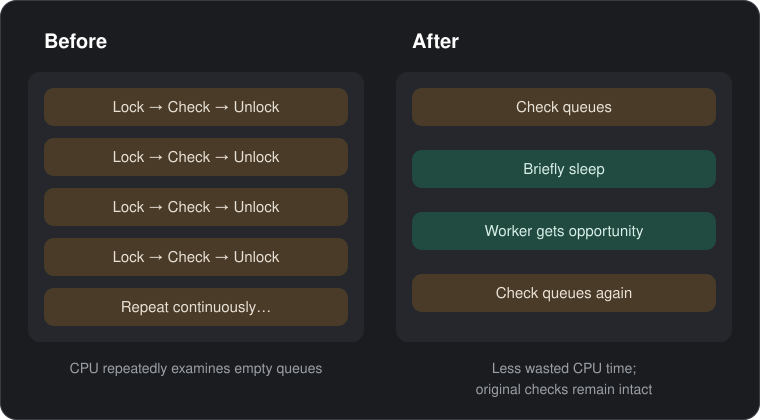
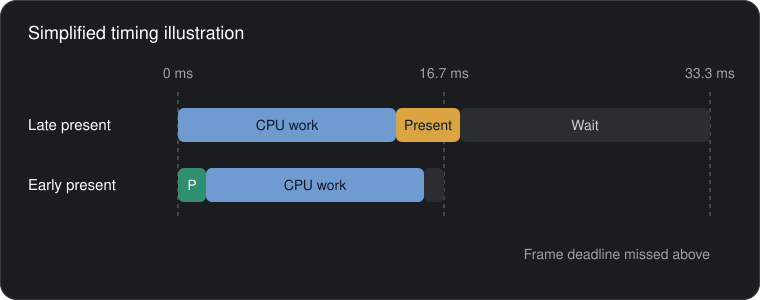
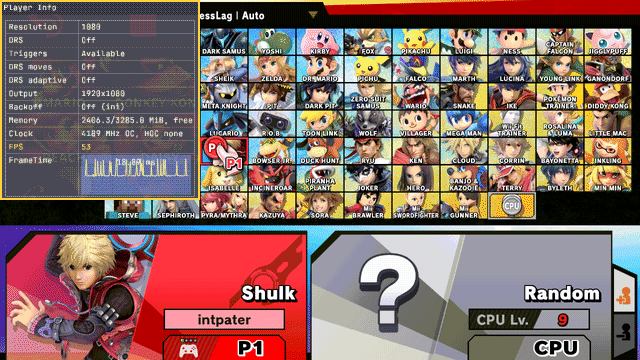
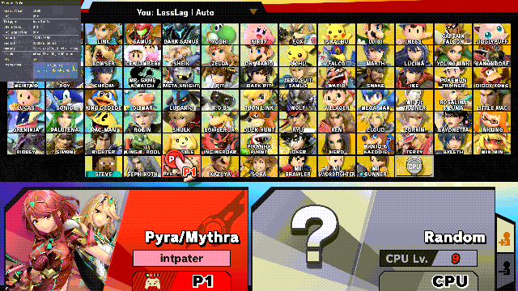
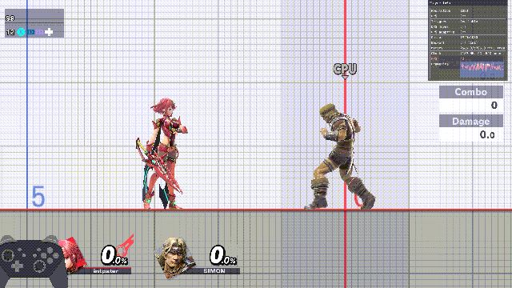
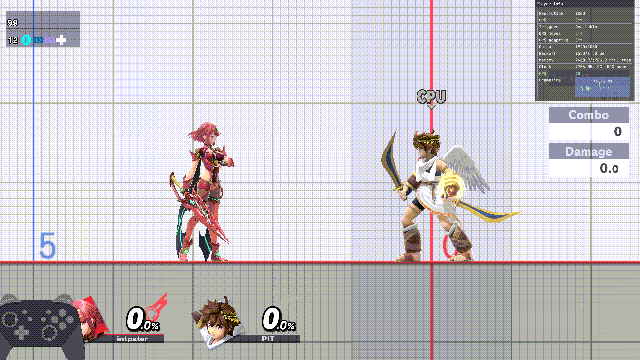
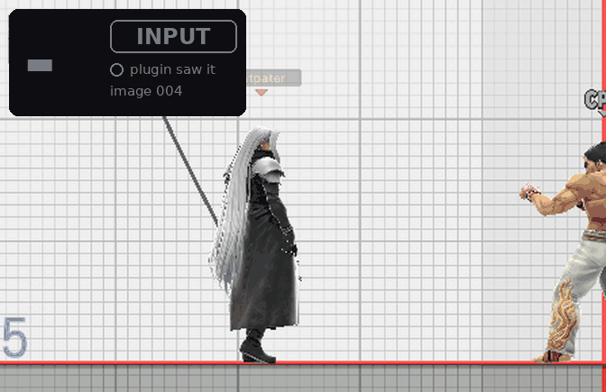

# Online Deluxe rewrite

> **Disclaimer:** this project was developed with the assistance of AI
> (Claude, Codex and other coding agents) under the operator's direction and
> review. Every build recorded here was tested as described in
> [validation](docs/VALIDATION.md); nothing is claimed beyond those records.

A Rust/Skyline reconstruction of Online Deluxe for **Super Smash Bros. Ultimate 13.0.5**,
delivered as **one NRO**: rendering profiles that cut input latency, a global
Player Info window, the native character-select status line and network
display. No overclocking.

**Current version: 0.5.7** (2026-10-18; release pending): the Streamer toggle is
L+R + **ZR** + Y only, since the ZL variant flipped it on unnoticed during a
console session. 0.5.6 (Forgejo release v0.5.6, on the card and booted) makes
**Vanilla+** the default mode: the Vanilla profile keeps the game's three-image
swap chain but presents at the flush, as the other profiles do; **L+R+X**
toggles it, and `vanilla_plus=false` in the INI turns it off (see Rendering
profiles below). It rests on code reasoning and console traces of the previous
build; the first console boot showed no early-present mismatch over 89,500
presents, and the visual check is still owed. 0.5.6 also lets console
LLUltra render at the native **1080p** (`ultra_resolution=1080` or the UltraRes
row; the default stays 576p; the operator reports that 720p LLUltra held 60
under Horizon OC, an uncaptured observation) and requires **ZR** for every
value change in the open window, in every scene instead of only mid-fight; both
are host-tested only. 0.5.5 (2026-10-18;
Forgejo release v0.5.5, on the card since 2026-10-18 with its first boot
pending) hides the opponent once their station goes silent
(see Network display below); its console check is owed. 0.5.4 (2026-10-17) is
the per-file code-reduction pass (31 % fewer production lines, behaviour
unchanged except where [validation](docs/VALIDATION.md) says otherwise) plus
the 0.5.2 and 0.5.3 changes described below: present at the flush for every
rendering profile, per-move and adaptive resolution triggers, plugin API v4
with SDK 5.0.0, the page toggles, UltraRes, the clock probe, the L+R-only
window chord and the early-present and backoff switches. 0.5.4 removes FPS++,
the opt-in peer observer and the Gigaflare resolution trigger. 0.5.1 added the render-opts teardown
guard (a crash at scene exits with render options active); 0.5.0 moved
character FX out to the separate
[FX Control](https://git.syntaxbyexample.com/intpa/ssbu-fx-control) plugin and
lets plugins add their own pages to the window cycle. Every release on Forgejo
carries the NRO and its manifest; the 0.5.4, 0.5.5 and 0.5.6 console runs are
still pending ([status](docs/STATUS.md)). Install notes: [docs/INSTALL.md](docs/INSTALL.md).

> **Install only this NRO.** The rewrite replaces the original Online Deluxe
> fork (`libssbu_online_deluxe*.nro`), SsbuSync (`libssbusync.nro`) and the
> PIA manager (`libssbu_pia_manager.nro`). Remove those three; do not run them
> next to `libssbu_online_deluxe_rewrite.nro`. The two do not stack: when
> SsbuSync is loaded, Deluxe switches every one of its hooks off, logs
> `Existing SsbuSync host detected; rewrite hooks skipped` (event code 16, `a` = 1),
> and you are playing the old fork without noticing. The fork's other
> companions, `libnx_over.nro` and `libsmashline_plugin.nro`, are not needed by
> Deluxe either; keep them only if another mod needs them.
> [What to remove, what to keep](docs/INSTALL.md#what-to-remove-what-to-keep).


| | |
| --- | --- |
|  <br> The Settings view in menus. |  <br> The native status line on the character select. |
|  <br> In a match the window becomes a compact two-row strip at the top left. |  <br> After a match the manual profile is held at Vanilla and the line reads `Vanilla*`. |

More in [Screenshots](docs/SCREENSHOTS.md).

## Optimizations added by this rewrite

For the rendering basics, see [How Deluxe LessLag and LLUltra work](docs/LESSLAG_LLULTRA.md).

Two things this rewrite does that the original Online Deluxe does not:

### Dispatcher backoff (smarter CPU waiting)

The game's main CPU task can waste time checking lists of work while another
task finishes. After enough checks find no work it can do, the rewrite briefly
sleeps, giving other CPU tasks a chance to run. Pauses grow to a small limit;
the game's locks (which keep tasks from interfering) and checks stay in place.



[How dispatcher backoff works](docs/DISPATCHER_BACKOFF.md).

### Present at the flush

Smash prepares frames ahead of when they appear on screen. Once a frame's
graphics commands are submitted (flushed), the CPU can start preparing the
next frame while the GPU finishes the previous one.

Originally, Smash waited until after the next frame's CPU update before
requesting presentation of the previous frame. That delay could miss a screen
refresh. In the affected rendering profiles, this rewrite queues presentation
right after the commands are submitted, giving the display system more time
to show the frame on schedule.

This does not make the CPU or GPU calculate frames faster. A presentation
request queues the image; the GPU may still be finishing it, and the screen
shows it at a later eligible refresh.



Conceptual timing diagram, not a measured trace. Both rows follow frame 99;
frame 100 takes the same CPU time in each.

[How present at the flush works](docs/RENDERING.md#present-at-the-flush-040).

### Before and after, on the emulator

Both additions have an INI switch since 0.5.3 (`early_present` and
`dispatcher_backoff`, default on; see [Configuration](docs/CONFIGURATION.md)),
so the same build can run the way the original Online Deluxe does. The clips
below were recorded in Eden under a CPU quota that reproduces the console's
character-select dip (an unbiased desktop emulator never drops a frame here;
[Mimicking the Switch in Eden](docs/EMULATOR_METHOD.md) explains the bias and
its limits), LessLag profile, with the Performance view open so the frame
rate and the Backoff row are visible. Left: both switches off (the upstream
behaviour). Right: both on.

| Scene | Both off (upstream behaviour) | Both on |
| --- | --- | --- |
| Character select, hand sweep |  |  |
| Training, LessLag, Pyra Blazing End |  |  |

The quota was calibrated against the console first: with both switches off,
175 % puts the character-select hand sweep at 50–53 fps, where the console
sat (49.9 fps) before the 0.4.0 fix. The same quota is used for both
columns. Full-size Performance stills from the character-select runs:
[off](docs/media/toggles-css-perf-off.png) ·
[on](docs/media/toggles-css-perf-on.png).

| Scene, 175 % CPU quota (calibrated) | Both off | Both on | Console, for comparison |
| --- | --- | --- | --- |
| Character select, hand sweep (FPS row / frame time in the clip) | 51 fps / 19.7 ms | 60 fps / 16.7 ms | 49.9 → 59.85 fps |
| Training, Pyra Blazing End vs Terry | 49 fps | 57 fps | LessLag Training holds 60 on the console |
| Backoff row | `Off (ini)` | 2 958/s · 50 µs (CSS), 1 780/s · 50 µs (Training) | — |
| `early_presents` over the run (`renderer-status.txt`) | 0 | one per frame | — |

Same build (`0.5.3-d10fce5eeb59`), same quota, same profile, same CPU
opponent; the clips are 6 s at 12 fps, 73 frames each, none dropped,
recorded at 1280 px and composed to 640 px with the Performance panel kept
at full resolution (the yellow frame).
Emulator clips show the mechanism, not console numbers; the console results
are in [Rendering profiles](docs/RENDERING.md#measured-results) and the
calibration in [Mimicking the Switch in Eden](docs/EMULATOR_METHOD.md).

## What it does

- **Rendering profiles.** Vanilla, LessLag, LLUltra and LLDoubles trade
  buffered frames for latency; Auto picks one from the scene. Since 0.4.0
  two-image LessLag presents at the flush, which removed the character-select
  stall on the console (49.9 → 59.85 fps on the hand sweep). Since 0.5.6 the
  default mode is **Vanilla+**: Vanilla's three-image chain presenting at the
  flush, toggled live with **L+R+X** (host-tested; console check owed). Console
  LLUltra can also render at 720p (0.5.3) or the native 1080p (0.5.6); both are
  host-tested with no console capture.
  [Rendering profiles](docs/RENDERING.md)
- **Player Info window and native status.** Settings, Performance, Debug and
  Plugins views on L+R+Down; the character select keeps your profile, buffer
  and the opponent's settings and RTT at the top. [Controls](docs/CONTROLS.md),
  [native display](docs/NATIVE_DISPLAY.md)
- **Network display.** Opponent name, interface, settings and colored RTT from
  the game's own measurement; Stealth and Streamer switches. Since 0.5.5 the
  opponent shows only while their station is live, that is, an RTT sample
  within the last 10 s, so a peer who declined a rematch drops off the
  screen (console check pending). [Controls](docs/CONTROLS.md)
- **Character FX moved out.** Since 0.5.0 the On, Off and Reduced character
  effects are the separate, optional plugin
  [`intpa/ssbu-fx-control`](https://git.syntaxbyexample.com/intpa/ssbu-fx-control)
  on Forgejo. Installed next to Deluxe, it adds an FX Control page to the
  window cycle and uses Deluxe's online tracking. Deluxe itself has no effect hooks.
- **Dispatcher backoff.** One inline hook that lets the game's idle dispatcher
  sleep instead of spinning. [Dispatcher backoff](docs/DISPATCHER_BACKOFF.md)
- **Plugins page and own pages.** Other mods register rows through an exported
  API and the Rust SDK, on the shared Plugins page or, since 0.5.0, on a page
  of their own. [Plugins](docs/PLUGINS.md), [`sdk/`](sdk/README.md)
- **Captures.** Opt-in 30 s character-select captures and whole-match captures
  streamed to the card for frame analysis. [Captures](docs/CAPTURES.md)

## Controls

Hold **L+R** and tap **D-pad Down** to cycle the window (ZL+ZR no longer
opens it since 0.5.3):
settings → plugins (when any registered) → own plugin pages, such as FX
Control when that plugin is installed → performance → hidden. In the window
**Up/Down** selects a row and **ZR + Left/Right** changes it. A plain
Left/Right is ignored, since the D-pad also taunts and moves the menus: the hold
applied only while a fight was live (Training or a match) in 0.5.3 to 0.5.5 and
applies in every scene since 0.5.6. L+R and **Plus** opens the Debug view; L+R
and **X** toggles Vanilla+ (0.5.6). Everything else,
including the ZL-gated native edits on the character select, is in
[Controls](docs/CONTROLS.md).

## Rendering profiles

| Profile | Textures | Presentation | Console | Emulator |
| --- | --- | --- | --- | --- |
| Vanilla | 3 | TwoBehind; with Vanilla+ (0.5.6, the default) presents at the flush | 1080p, DRS off | 1080p, DRS off |
| LessLag | 2 | OneBehind, presents at the flush | 1080p, DRS on | 1080p, DRS off |
| LLUltra | 2 | Immediate, earlier flush, presents at the flush (0.5.2) | 576p, DRS on (UltraRes row or `ultra_resolution=720` / `1080` raises it to 720p or, since 0.5.6, the native 1080p) | 1080p, DRS off |
| LLDoubles | 3 | OneBehind, presents at the flush (0.5.2) | 1080p, DRS on | 1080p, DRS on |

Auto uses Vanilla in menus, offline matches and Training; online singles get
LessLag on console or LLUltra on emulator; online matches with more than two
fighters get LLDoubles. How Auto recognises an online match, the cleanup hold
(`Vanilla*`) and DRS are in [Rendering profiles](docs/RENDERING.md).

### Measured input delay

Captured-response trials in Eden: frames from a synthetic input to the first
visible response, three trials per cell, at two injection phases. The earlier
build is identified by its binary hash, `b19b7d94ae136e55…`. The 0.5.2
columns are the 0.5.2
NRO `1525e3e0` (build `0.5.2-ce0145a2155c`), measured on 2026-10-15
with the same method, after LLUltra and LLDoubles started presenting at the
flush as LessLag does.

| Profile | Normal phase ([earlier build](docs/PERFORMANCE.md#final-renderer-regression-2026-10-07)) | Later phase ([earlier build](docs/PERFORMANCE.md#final-renderer-regression-2026-10-07)) | Normal phase (0.5.2) | Later phase (0.5.2) | Frames saved vs Vanilla (0.5.2) |
| --- | --- | --- | --- | --- | --- |
| Vanilla | 6, 6, 6 | 6, 6, 6 | 6, 6, 6 | 6, 6, 6 | — |
| LessLag | 3, 3, 3 | 3, 3, 3 | 3, 3, 3 | 3, 3, 3 | **3** |
| LLUltra | 2, 2, 2 | 3, 2, 3 | 2, 2, 2 | 2, 3, 3 | **4** normal, **3–4** later |
| LLDoubles | 4, 4, 4 | 4, 4, 4 | 4, 4, 4 | 4, 4, 5 | **2** normal, **1–2** later |

On 0.5.2 LLUltra still shows one captured frame fewer than LessLag when the
input lands at the normal phase (2 against 3 in all three trials). At the later
phase the two are within a frame: LLUltra 2, 3, 3 against LessLag 3, 3, 3, and
the one 2 is in a trial whose API trace was not captured. Present-at-flush
did not change the captured-image counts of any profile; its purpose is the
console frame-time stall, which these trials do not measure. Seven of the 24
0.5.2 trials (all in the later phase) are not covered by their API trace
export and rest on the in-game marker's consecutive present identities alone.

Each frame below is a real 640×360 capture from one included trial (normal
phase, trial 1), played at about three frames per second. The number counts
captured frames from the first image after the stick-down was injected up to
the first image showing the crouch (green); INPUT lights from that first image,
and the small "plugin saw it" lamp lights when the in-game input marker first
shows the Down bit.

| Vanilla: 6 frames | LessLag: 3 frames | LLUltra: 2 frames | LLUltra, late press: 3 frames |
| --- | --- | --- | --- |
|  |  |  |  |

The fourth clip is LLUltra again, with the stick pressed about 8 ms later
(later phase, trial 2). The crouch appears after 3 captured frames rather than
2 in the normal-phase trial, saving 3 frames against Vanilla instead of 4.
Later input may miss a processing deadline, but these captures do not establish
that cause or locate the game's first input read. Across the six 0.5.2 LLUltra
trials, the 2-frame result occurred four times and the 3-frame result twice.

LLDoubles was measured as a manual profile in two-fighter Training. These are
emulator screenshots with synthetic input, not Switch input-to-photon
measurements. The earlier columns predate 0.4.0's present-at-flush change to
LessLag, which removed the console's character-select stall (49.9 → 59.85 fps
on the hand sweep) without changing the frame count claim; the 0.5.0 release
NRO re-measured on 2026-10-15 gave Vanilla 6, LessLag 3, LLUltra 2 (normal) and
2–3 (delayed), and 0.5.2 gives the same counts. Method and every result set:
[LATENCY_METHODOLOGY.md](docs/LATENCY_METHODOLOGY.md); original full results:
[PERFORMANCE.md](docs/PERFORMANCE.md).
## Configuration

`sd:/ultimate/ssbu_online_deluxe_rewrite/config.ini`, created with defaults on
first boot; menu edits are saved automatically. Keys, boot flags and the Eden
overrides are in [Configuration](docs/CONFIGURATION.md).

## Diagnostics

Logs live under `sd:/ultimate/ssbu_online_deluxe_rewrite/` (`install.log`,
`events.log`, `hang-trace.log`, `renderer-status.txt`, `panic.log`). Keep the
exact NRO and its debug bundle when reporting a crash. Event codes, log
formats, bisection flags and the Eden test lifecycle are in
[Debugging](docs/DEBUGGING.md).

## Build

```powershell
cargo clippy --all-targets -- -D warnings
cargo build --no-default-features
cargo test
cargo skyline clippy -- -- -D warnings
/usr/bin/pwsh -NoLogo -NoProfile -NonInteractive -Command '& ./tools/Build.ps1 -Package'
```

Toolchain, native dependency and release steps: [Build](docs/BUILD.md).

## Documentation

| Topic | Document |
| --- | --- |
| Install, coexistence with other plugins, rollback | [INSTALL.md](docs/INSTALL.md) |
| Controls and the settings rows | [CONTROLS.md](docs/CONTROLS.md) |
| Screenshots and GIFs | [SCREENSHOTS.md](docs/SCREENSHOTS.md) |
| Rendering profiles, Auto, present-at-flush, measured results | [RENDERING.md](docs/RENDERING.md) |
| Mimicking the Switch in Eden (CPU quota bias for clips and A/B runs) | [EMULATOR_METHOD.md](docs/EMULATOR_METHOD.md) |
| Native character-select and arena display | [NATIVE_DISPLAY.md](docs/NATIVE_DISPLAY.md) |
| Dispatcher backoff | [DISPATCHER_BACKOFF.md](docs/DISPATCHER_BACKOFF.md) |
| How another plugin plugs in (menu rows, or its own ImGui windows) | [PLUGINS.md](docs/PLUGINS.md), [sdk/README.md](sdk/README.md) |
| Timing captures | [CAPTURES.md](docs/CAPTURES.md) |
| Configuration keys and boot flags | [CONFIGURATION.md](docs/CONFIGURATION.md) |
| Logs, event codes, crash diagnosis, Eden test lifecycle | [DEBUGGING.md](docs/DEBUGGING.md) |
| Performance measurement method and results | [PERFORMANCE.md](docs/PERFORMANCE.md), [LATENCY_METHODOLOGY.md](docs/LATENCY_METHODOLOGY.md) |
| Build, toolchain, release | [BUILD.md](docs/BUILD.md), [IMGUI_DEPENDENCY.md](docs/IMGUI_DEPENDENCY.md) |
| Validation ledger (every build, install and console result) | [VALIDATION.md](docs/VALIDATION.md), [STATUS.md](docs/STATUS.md) |
| Fork provenance and deliberate differences | [reference/README.md](reference/README.md), [FORK_PARITY.md](docs/FORK_PARITY.md) |

Client-side rendering changes avoid gameplay and RNG modifications.
Linked-match results are evidence for the trials they cover, not proof that
every online scenario is desync-free.
