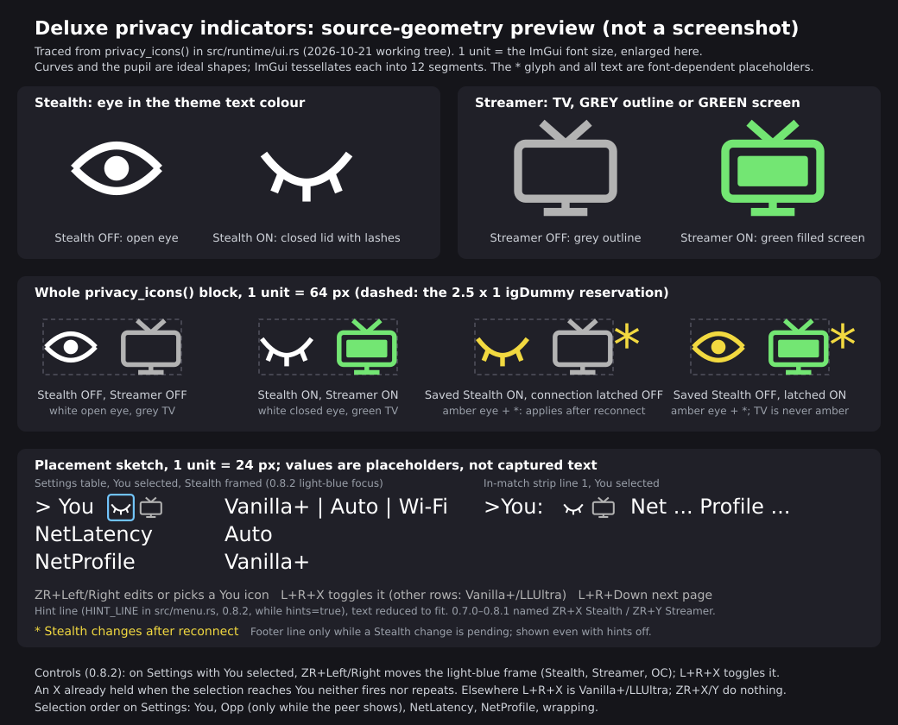
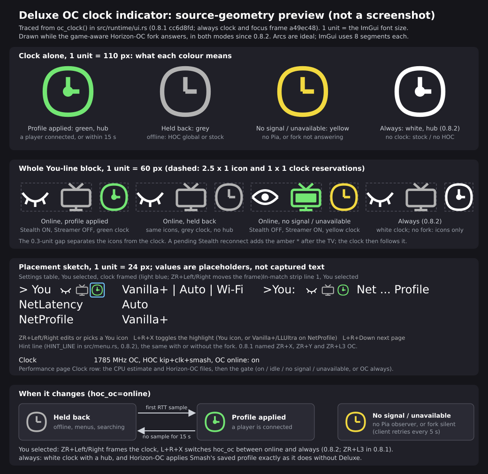

# Controls and settings

The compact You-line icons and LLUltra controls below are new in 0.7.0;
older 0.6.2 has separate privacy and UltraRes rows.

Hold **L+R**, then tap **D-pad Down** to cycle
**settings → performance → window options → hidden**. When a separately installed plugin NRO has
registered options, a **plugins** page sits between settings and performance,
and a plugin with its own page (since 0.5.0) follows it (see [Plugins](PLUGINS.md)).
With the separate [FX Control](https://git.syntaxbyexample.com/intpa/ssbu-fx-control)
plugin installed, its **FX Control** page appears in that cycle; character FX
is no longer a Deluxe row. The **Window Options** page (0.6.0) is the last page of the
cycle and is always in it; it holds the page toggles and the other settings of
the window itself. The small Player Info window works in menus,
character select and matches. It moves to the right in Training and connected
lobbies, keeping the pause controls visible, and stays left in regular matches.

Character select also keeps the fork-style native status at the top after the
window closes. It shows your selected profile and input buffer, plus the selected
opponent's available settings and colored RTT. Edit values in the window;
Streamer restores the game's original title and background. Arena text uses the
fork's room-ID path, but still needs an NSO test. See [native display](NATIVE_DISPLAY.md).

| Control | Action |
| --- | --- |
| L+R + Down | Cycle settings → (plugins) → (own plugin pages) → performance → window options → hidden. The Window Options page rows PluginsPage, OwnPages and PerfPage (or `hide_pages` in the INI, 0.5.3; the rows moved from Settings to the Window Options page in 0.6.0) take pages out of the cycle, e.g. settings → FX Control → window options → hidden; Settings and Window Options are always in it. See [Configuration](CONFIGURATION.md) |
| Up / Down | Move the selection; it wraps within the page. **Settings**: You (the first row, carrying the privacy icons), the Opp line (only while the peer shows), NetLatency, NetProfile. You has no Left/Right value; its only edits are the ZR + X / Y privacy shortcuts below. There are no separate Stealth or Streamer rows. **Window Options**: PluginsPage / OwnPages / PerfPage (Shown or Hidden), PerfView (Graph or Number) and Hints (Shown or Hidden). On a plugin page, the plugin's rows |
| Left / Right (window open) | Does not change a value since 0.5.6; the window ignores a plain press in every scene (until 0.5.5 it changed values in menus and on the character select). Use ZR + Left / Right below |
| ZR + Left / Right | Change the selected value on any Settings row, Window Options row or plugin row; on the Opp line (Settings) it cycles the selected remote station, what the Peer row did before 0.6.0. The hold is required in **every scene since 0.5.6** (menus, character select, Training and matches); in 0.5.3–0.5.5 it applied only while a fight was live (Training, Singles, Doubles). A plain Left/Right is ignored, so a menu D-pad press, a taunt or a stray press cannot change a setting (operator rule, 2026-10-18); Up/Down still move the selection. Since 0.6.0 the selected row's value reads `< value >` (for example `< Auto >`) while ZR is held and is plain text without it, on Settings, Window Options and in the match strip. ZR rather than ZL because ZL + D-pad Left/Right in Training swaps the controlled fighter. Window closed, the ZL-gated native pane edits below are unchanged |
| Shoulder chord + Left / Right outside Settings and Window Options | Cycle the selected remote peer |
| ZL + Left / Right or Up / Down on an online character select or arena pane, window closed | Edit the input buffer or the profile on the native status (since 0.4.1 the D-pad alone only moves the hand) |
| ZR + X (Settings, You selected) | Toggle Stealth; the You-line eye closes when enabled and opens when disabled. A session-latched change is amber with `*` and a reconnect notice |
| ZR + Y (Settings, You selected) | Toggle Streamer; the You-line TV has a green filled screen when enabled and a grey outline when disabled. These privacy shortcuts work only while the Settings page has **You** selected (`> You` in the table, `>You:` in the match strip), with ZR held and ZL released: each new X or Y press toggles once. A held button does not repeat, and one already held when the selection reaches You does not fire. They do nothing on other rows, on other pages or with the window hidden |
| ZR + L3 (Settings, any row) | 0.8.1, only while the game-aware Horizon-OC fork answers: switch `hoc_oc` between **always** (Horizon-OC applies Smash's saved profile whenever Smash runs, as it always has) and **online** (the profile applies only while connected to another player, internet or local wireless, and for 15 s after the last player disconnects). Saved to the INI. One toggle per new L3 press with ZR held and ZL released. With stock Horizon-OC or none, the press does nothing and the hint line does not name it |
| L+R + X (neither ZL nor ZR held) | With manual console LLUltra selected, cycle 576p → 720p → 1080p → 576p in place (LLUltra → LLUltra+ → LLUltra++ → LLUltra), saving `ultra_resolution`. For Auto, the emulator and every other profile, toggle and save Vanilla+ instead (0.5.6). A new X press is required; holding X does not repeat. See [Rendering profiles](RENDERING.md#vanilla-056) |
| L+R + Plus or Minus | Open the debug view; again to hide it. ZL+ZR stopped being a window chord in 0.5.3, so a trigger chord during play cannot open the window |
| L+R + Up in the Debug view | Start a 30 s timing capture (see [Captures](CAPTURES.md)) |
| L+R + Left in the Debug view | Coverage build only: write a `manual-NNN.profraw` snapshot (see [Coverage build](DEBUGGING.md#coverage-build-052)) |

The window commands fire when the whole combination is held, in any press
order, and once per press: L+R+Down works whether the bumpers or the D-pad
land first. Holding Plus or Minus while tapping Down with the chord opens Debug
from Settings, Plugins, an own plugin page or Window Options and keeps Debug
open; a plain chord then continues from Debug to Performance (to Window Options
when Performance is hidden). From hidden the chord still opens Settings, and from
Window Options (the last page, since 0.6.0) it hides the window.

The first controller operates the window. Input also reaches the game. If
Elite's menu is open too, D-pad edits can affect both menus; close one before
changing settings. On Eden the chord is the two keys mapped to L and R plus
Down Arrow (the ZL/ZR keys no longer work since 0.5.3).

## Settings page

Until 0.5.7 the first page was one table of up to 14 rows in three columns
(label, You, Opponent) with the 11-row Performance block and the frame-time plot
under it. Since 0.6.0 it has two columns (a label and your value, no opponent
column) and reads top to bottom as follows. The window title is still Player
Info.

**You** carries the Stealth eye and Streamer TV icons beside its label, followed
by the summary `<profile> | <buffer> | <interface>`, for
example `Vanilla+ | Auto | Wi-Fi`; since 0.6.2 an Auto buffer carries the frames
the game chose, `Vanilla+ | Auto (4f) | Wi-Fi` (see NetLatency below). The
` | ` separator is the one the native character-select banner already uses
(ASCII on purpose). Interface shows the local Wi-Fi/Ethernet/Unknown type; an
emulator's reported interface can be virtual and does not identify the host
computer's physical network connection.

The icons are drawn geometry, so no eye/TV font glyph or emoji support is
required. They reflect the saved settings. If Stealth differs from the current
connection's latched value, its eye is amber with `*`; a reconnect notice remains
visible even when Hints is hidden. Select You, then toggle with ZR+X / ZR+Y.

With `hoc_oc=online` and the game-aware Horizon-OC fork answering (0.8.1), a
small clock follows the privacy icons, on the table's You row and the strip's
`You:` alike: green with a centre hub while Smash's saved Horizon-OC profile is
applied, grey while Horizon-OC's own fallback holds (offline, and from 15 s
after the last player disconnects unless one reconnects), yellow when there is
no Pia signal or the fork stopped answering.
It is drawn geometry like the icons and adds no row. The Performance **Clock**
row appends the same state (`OC online: on`, `OC online: idle`,
`OC always`, `OC online: no signal`, `OC online: unavailable`), wrapped onto a
second line.

Captured in Eden with the test-only Horizon-OC stand-in
([hoc-standin](../tools/hoc-standin/README.md)); offline, so the clock is grey.

The image above is an enlarged redraw of `privacy_icons` in `src/runtime/ui.rs`
at the source's coordinates and colours, not a screenshot; text in it is a
placeholder.

The clock image is the same kind of redraw, of `oc_clock` and its place after
the privacy icons: green with a hub (profile applied), grey (held back), yellow
(no signal or the fork not answering), and no clock at all with
`hoc_oc=always` or without the fork. Its last panel shows when the clock
changes.

**Opp** appears only while the peer shows (Streamer off, and a connected, live
station): `<name> | <announced profile> | <announced buffer> | <ping> |
<interface>`, for example `Mario | LessLag | 3 | 23ms | Ethernet`. A fact the
peer has not announced, or an RTT that is not known yet, is left out of the line
(no `---` placeholders), and the interface is the peer's announced type, if
available. The whole line is painted in the ping's stability colour (the fork's
green, yellow or red). It is a selectable line: with ZR held, Left/Right cycles
the selected remote station, which is what the Peer row did. It replaces the
Name, Interface, Peer and Ping rows and the opponent column.

Under them the table has two controls: **NetLatency** and **NetProfile**.
The old Status row is folded into NetProfile's value. Console LLUltra is one
NetProfile stop, labeled LLUltra / LLUltra+ / LLUltra++ for the saved
resolution, and L+R+X cycles that label in place. There is no separate UltraRes
row. The window's settings stay on Window Options.

A one-line performance footer sits under the table in the frame-time colour:
`60.0 fps | 16.67 ms | 1080p | DRS on` (fps, mean frame time, the applied
resolution, DRS state), or `--- fps | --- ms | ...` until a frame time exists.
The full Performance block and the frame-time plot are on the Performance page
(and in Debug) only.

A dim grey hint line under the footer, wrapping to the window width, lists the
chords: `ZR+Left/Right edits   ZR+X Stealth   ZR+Y Streamer   L+R+Down next page   L+R+X Vanilla+/LLUltra`.
The ZR+X/Y entries carry no "You selected" prefix because the row marker and
icons already show the selection; they still act only with Settings' **You**
row highlighted, ZR held and ZL released (see the table above). The earlier
`5a2a5f05` candidate showed the `You selected: ZR+X Stealth / ZR+Y
Streamer` wording. The hint line is on by default; `hints=false` in the INI or the Window Options page's
**Hints** row (Shown / Hidden) turns it off ([Configuration](CONFIGURATION.md)).

## Window Options page (0.6.0; retitled 0.6.1)

The last page of the L+R+Down cycle, titled **Window Options** since 0.6.1 (0.6.0
titled it just **Window**) and always in the cycle.
Its rows are **PluginsPage**, **OwnPages** and **PerfPage** (Shown / Hidden;
they toggle `hide_pages` live, as the same rows did on Settings before 0.6.0),
**PerfView** (Graph / Number; since 0.6.0 it affects the Performance and Debug
pages only, because Settings has the one-line footer) and **Hints** (Shown /
Hidden, the `hints` key). The same hint line is under the table (no performance
footer). ZR + Left/Right edits, Up/Down move the selection and it wraps within
the page.

## In-match strip (0.6.0)

In a ready Singles or Doubles match the window is the compact two-line strip.
Line 1 of the Settings strip is `You:` (`>You:` while You is selected) with the
two privacy icons, then `Net`
and `Profile`; the `PlugPg`, `OwnPg`, `PerfPg` and `PerfView` fields moved to the
Window Options page's strip, which shows them plus `Hints`. Line 2 is
`>Opp:<name> | <profile> | <buffer> | <ping> | <interface>` (when the peer
shows) followed by the timing line `FPS:.. FT:.. AVG:.. [####------]`. The old
`Peer:`, `IF:`, `Ping:`, `PeerNet:` and `PeerProfile:` fields are gone. The
`< value >` marker applies to the strip's selected field too.
A pending Stealth change adds `* Stealth: reconnect` to line 2.

## Rows

**NetLatency** is the game's online input buffer, **Auto or 0–25**. It is
separate from NetProfile's rendering policy. A menu change takes effect at once
and is written to `config.ini` by the background thread within about half a
second; the game's next relevant buffer hook applies the selected value.

Since 0.6.2 an **Auto** selection shows the game's buffer as `Auto (4f)`
(`Auto (25f)` is the longest). **0.8.0 scopes the count to each match** and
samples the byte where the network update consumes it. A new match starts with
plain `Auto` until a valid observation arrives, then the count can update during
play. The last count remains through results and rematch character select;
Offline, Training, a connection-mode change and the next match clear it. Choosing a manual buffer clears
Auto's observation, and switching back to Auto stays plain until the next match
so a manually overwritten byte cannot masquerade as the game's Auto choice.
A manual buffer still reads its number. The Auto count appears on the You line,
the NetLatency row, the in-match
strip's `Net:` field and the native character-select and arena `You:` line
(`You: Auto:Van | Auto (4f)`); the local-wireless lobby's one-digit pane keeps
plain `Auto`. The Opp line still shows the opponent's announced `Auto`, not their
frame count.

**NetProfile** selects the rendering profile or Auto; see
[Rendering profiles](RENDERING.md). Since 0.6.0 the value carries the status
the Status row used to show: `LessLag | Swap`, `Auto:LLDbl | Active`; an empty
status, or the uninformative `Vanilla` status, shows the profile alone. Since
0.5.6 the Vanilla entry reads `Vanilla+` while Vanilla+ is on (the default; `Auto:Van+` under Auto), and plain
`Vanilla` (`Auto:Van`) when it is off; the in-match strip's `Profile:` field
and the native CSS banner's `You:` field use the same text. There is no separate
Vanilla+ entry in the NetProfile cycle: L+R+X flips the flag, except while
manual console LLUltra is selected, where that same chord cycles the resolution
instead. A manual
selection that the post-match cleanup hold is running as Vanilla reads
`Vanilla+*` (`Vanilla*` with the flag off).

On a console, manual LLUltra is one NetProfile stop. Its label is **LLUltra**
(576p), **LLUltra+** (720p) or **LLUltra++** (1080p), naming the saved
`ultra_resolution`. Left or Right leaves that stop for the adjacent profile
and keeps the resolution; entering LLUltra again shows the saved level,
including an existing 720p or 1080p INI. While that manual console selection
is current, the same **L+R+X** chord cycles it in place: 576 → 720 → 1080 →
576, without changing the mode, Auto or Vanilla+. Auto, an emulator and every
other profile keep the Vanilla+ toggle and leave `ultra_resolution` unchanged.
The closed-window native profile edits use the same one-stop sequence.
Emulator LLUltra has one stop because its resolution policy ignores this
setting. The suffix names the base resolution; DRS can still lower the applied
resolution shown in the performance footer. Auto's selection and labels are
unchanged. Peer announcements keep their existing wire format and names; these
suffixes are local presentation only.

**Stealth** defaults to **On** and suppresses this mod's recognition beacon and
custom settings payload. Its value is latched for the connection. A change
during a connection shows a reconnect notice and takes effect on the next one.
It does not promise anonymity or detection avoidance by Nintendo.

**Streamer** hides remote names, connection types, settings and ping; it does
not change network traffic. Peer RTT uses the game's existing measurement and
the fork's stability colors. The Opp line (before 0.6.0 the opponent column)
appears only for a connected, identified station; a connected peer with unknown
RTT still appears, with the unknown facts left out of the line.
Since 0.5.5 the station must also be live, meaning a measured RTT sample within
the last 10 s (a new binding gets a 10 s grace); a bound station that goes
silent, as after an opponent declines a rematch, is hidden (the Opp line, the
match strip's `>Opp:` line and the CSS line included) and logs event code 112.
Console behaviour of this rule is untested. Streamer is indicated by the TV icon
in both the vertical window and match strip.

The fork's **FPS++** row was removed on 2026-10-17, and its L+R+ZL/ZR+X chord
with it. Since 0.5.6 plain **L+R+X** (neither ZL nor ZR held) toggles Vanilla+
instead, except while manual console LLUltra is selected: that same chord then
cycles LLUltra → LLUltra+ → LLUltra++ → LLUltra and leaves Vanilla+ unchanged.
ZL+X still does nothing, and ZR+X with You selected on Settings is now
the Stealth shortcut.
See [Rendering profiles](RENDERING.md#fps)
and [Vanilla+](RENDERING.md#vanilla-056).
