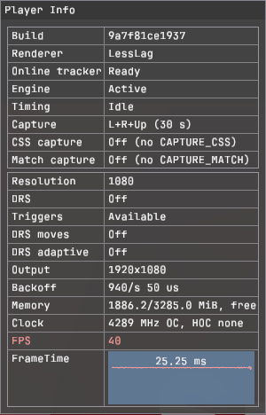

# Diagnosing crashes



The Debug view (L+R+Plus or Minus) shows the build's commit, renderer, online
tracker, engine, `Timing`, `Capture L+R+Up (30 s)`, `CSS capture` and
`Match capture`, then the Performance rows (resolution, DRS, output, backoff,
memory, clock, FPS and frame time). Since 0.10.5 (not released yet) the chord
opens it only with `debug_view=on` in `config.ini` (default off), and never
while A is held; in 0.10.4 and earlier the chord always toggles it. The image
was captured in Eden on 2026-10-24 with released 0.7.0, build `9a7f81ce1937`:
Timing is Idle and the CSS/match capture flags are off. See [Media provenance](MEDIA_PROVENANCE.md)
for the build and [Screenshots](SCREENSHOTS.md) for the whole-screen and Training views.

Keep the exact dist/<NRO-hash-prefix>/ bundle for every installed build.
Packaging checks matching NRO/ELF executable bytes, saves both SHA-256 hashes,
the NRO module ID, compiler identity, complete source and native dependency provenance.
The optimized ELF retains DWARF and symbols.

Under sd:/ultimate/ssbu_online_deluxe_rewrite/:

- install.log: earliest startup phases, identity/base addresses, and synchronous before/after hook checkpoints.
  Previous boot: install.previous.log.
- events.log: background snapshots flushed every 500 ms. One previous log is retained;
  each is capped at 4 MiB.
- matches/NNNNNN-<scene>-<stage>.log (0.9.0): one log per stage load (Training,
  Singles or Doubles, including lobby practice), so a session of many matches
  needs no manual rotation. `matches/index.txt` lists the kept logs; the newest
  60 are kept, numbered on across boots. Always on, no flag.
  - The header has the build, stage, scene, connection, the full settings, the
    render profile (`render_start selected/auto_profile/requested/committed/effective`,
    textures, present interval), the clock probe, and every line of
    `ultimate/ssbu-refresh-clock/status.txt` as `refresh_clock_start.*`.
    `refresh_clock_start=absent` appears without that plugin. Its `interval_*`
    counters are live only when its `telemetry.flag` existed when Smash started.
  - Then come the stage's `events.log` rows. These include a code 120 row every
    5 s with the refresh-clock counters, which gives a time series for each
    match.
  - The footer is written when the next stage loads or the scene context (code
    73) turns Inactive. It has the stage length, actual presents, early presents,
    skips, mismatches, pacing outliers (code 117) and reacquires (code 118). It
    also has `present_spacing` (counts of present-to-present spacing in <6, 6–10,
    10–14, 14–19, 19–25, 25–40 and ≥40 ms bins), the render state at the end
    (`render_end`), the clock, and the refresh-clock status again
    (`refresh_clock_end.*`).
  - At 60 FPS nearly every present falls in 14–19 ms. Two presents per 60 Hz
    frame at 120 Hz would fill 6–10 ms. Change profiles in-game between matches
    and each match's log records which profile it ran, so a 120 Hz A/B fits in
    one boot.
- panic.log: best-effort Rust panic message/location and recent events. Retained until another panic.
- config.ini: saved settings; invalid input is reported and preserved. config.previous.ini
  retains the last good version and is recovered if replacement was interrupted.
  Switch RenameFile cannot overwrite an existing destination: save closes the temp file,
  parks the original in the backup, then promotes temp to the now-absent destination.
- timing-<tick>.csv: opt-in render-callback traces (30 s; a `CAPTURE_MATCH`
  capture runs to the end of the match, ten minutes at most); timing-status.txt
  reports capture/export failures. See [measurement procedure](PERFORMANCE.md).
  Both CSVs stream while the capture runs: header at arm time, rows every
  poll, `# engine/reason/skipped` and `sample_count` (`event_count` in the API
  CSV) in the footer before `# complete=1`.
- api-<tick>.csv: paired CPU spans around render APIs. These are not GPU or display
  times. Analyze with tools/analyze_render_trace.py.
- renderer-status.txt: actual active mode, texture counts/index masks and cumulative
  hook counters, including `early_presents`, `early_present_skips` and
  `early_present_mismatches` for the present-at-flush path (0.4.0 LessLag;
  0.5.2 LLUltra and LLDoubles). Since 0.10.4 it also has `imgui_font_*` lines
  (fonts, glyph sets, rebuilds, texture and index bytes).
  Values are independent observations, not an atomic frame snapshot.

128 fixed-size events use a nonblocking try-lock. Game hooks do no file I/O; contention
increments a dropped counter. Startup install checkpoints are synchronous. The sink reports
overwritten sequences/drops. File/thread failures are reported to Skyline.
Up to the latest 500 ms may be absent after an abrupt crash; this is not a crash dump.

Startup phases begin before version/configuration queries and the event recorder.
Module addresses come from this NRO's hidden linker symbols (__text_start and
__bss_end), with a mapped-memory check before reading its header. Do not replace
this with skyline::info::containing_plugin: in the installed Skyline versions,
that helper enters a different C++ singleton from the loader's manager and caused
an nn::os::LockMutex abort during our first Eden test. The phase log isolated the
call; replacing it allowed the same mod stack to boot.

Keep backup NROs outside the entire skyline/plugins tree. Skyline recursively
tries every file as an NRO, including .nro.bak files. Its asynchronous console
output can lag the fault: the last printed plugin name is not proof of its cause.

The panic hook chains the previous mod's hook. panic=abort cannot recover through catch_unwind.
Hardware exceptions, GPU faults and hangs do not invoke it. Collect Atmosphere/emulator crash
logs too: module list, PC/LR/backtrace, game version, loaded NROs and reproduction steps.

    /usr/bin/python3 tools/symbolicate.py dist/<hash> 0x<plugin-relative-PC>
    /usr/bin/python3 tools/symbolicate.py dist/<hash> 0x<absolute-PC> --base 0x<plugin-base> --module-id <crash-module-id>

The script verifies bundle hashes and optional module ID, then uses LLVM/binutils addr2line.
Use the faulting plugin's base/ELF, not the game's main-module base.

For controlled bisection, create empty DISABLE_MENU, DISABLE_SCENE,
DISABLE_BUFFER, DISABLE_RENDERER, DISABLE_PIA, DISABLE_NATIVE or DISABLE_BACKOFF
files in the data directory and restart. They skip the corresponding hook
family. DISABLE_SCENE skips the scene tracker (main menu, Quickplay, arena,
local wireless, stage setup): Auto then never becomes ready, banners stay
hidden, the match capture never arms and the exported online context reports
nothing (it was part of the FX family until 0.4.2). DISABLE_BUFFER disables
input-buffer writes. DISABLE_RENDERER skips
experimental rendering text patches regardless of the INI request; actual mode
stays Vanilla. DISABLE_PIA skips RTT, and the connection transport (which
needs the Pia cleanup hook) then does not install either; without Pia samples
the shared online session is never live, so `hoc_oc=online` holds Smash's
Horizon-OC profile back everywhere (0.8.1). DISABLE_NATIVE skips
the native banner hook. DISABLE_BACKOFF
skips the dispatcher idle backoff (code 102 `a` = 4). DISABLE_HOC (0.8.1)
does not start the game-aware Horizon-OC client thread; it installs no hook,
and Horizon-OC then behaves exactly as without Deluxe. All seven hook-family
flags together skip those hook families while retaining logging.
Remove the disable flags to re-enable their hook families.
DISABLE_FX and the PROBE_CRITICAL_SCREEN marker are ignored since 0.5.0: the
FX hook family moved to the separate ssbu-fx-control plugin, which has its own
data directory and flags.

| Code | Meaning |
|---|---|
| 1 / 2 | Boot / unsupported game version |
| 3 / 4 / 5 | Hook installing / installed / rejected |
| 6 / 7 | Config loaded (a = 0, b = input buffer) / rejected |
| 8 | Setting changed: a = 0, b = input buffer |
| 9 / 10 | Network buffer applied (a = the byte at the calculation hook before our selection is applied; b = the applied value) / null pointer skipped. Versions 0.6.2–0.7.0 used a for the Auto display; 0.8.0 uses event 113's current-match observations instead. |
| 12 / 13 | Sampled CSS entry / exit |
| 14 / 15 / 16 | Panic / heartbeat (a = 0, b = iteration) / compatibility or diagnostic flag |
| 17 | Shared function hook entry instruction before chaining |
| 18 / 19 | Native status-line pane. 18: the first write to a pane in this scene (a, b = the first 16 bytes of its name). 19: a pane refused (a = hook site; b = reason: 1 pane chain, 2 pane check with the failed check in bits 8–15, 3 text, 4 does not fit, 5 no Arena room id; at the local-wireless scene entry, the pane address) |
| 20 | Pane detail, after a code 18 or 19 or alone: the pane address and vtable, or the first 16 bytes of a pane name |
| 21 / 22 | Global overlay entry / exit, sampled every 300 frames |
| 23 | View change (a = previous view, b = new view): 0 hidden, 1 settings, 2 performance, 3 debug, 4 plugins, 5 a plugin's own page (0.5.0), 6 Window Options (0.6.0) |
| 24 | Config saved: a = generation; b = bit n for each key slot the save changed (0.9.0; slots in `config::key_slot`: 2 `render_mode`, 3 `auto_profile`, 15 `early_present`, 17 `vanilla_plus`, 19 `hoc_oc`, 20 `hide_plugin_pages`, 21 `debug_view`, …), 0 before 0.9.0 |
| 25 | Overlay health: backend ready / bootstrap-call count |
| 26 | Overlay backend ready: a = `0x201` for the embedded backend, `0x202` for a standalone imgui-smash NRO's; b = bootstrap-call count |
| 30 | Online context changed (`OnlineContext`, `FxOnlineContext` before 0.5.0): online boolean / source scene or latency-setup offset |
| 31 / 32 | Timing capture started / export finished: a = capture ID; b = 1 for a `CAPTURE_MATCH` capture (code 31) / export success (code 32) |
| 33 / 34 / 35 | Renderer owner / caller / flush target diagnostics |
| 36 | Pia RTT sample/cleanup and foreign/drop counters |
| 48 | Render-opts teardown guard fired: a module unloaded between the frame's fighter recording and its post-scene hook, so the relocated model update and fighter worker were skipped and the game's own ordering runs for the next 180 frames. a = unload epoch, b = scene frame |
| 46 / 47 | Render-policy transition / refused transition or invalid post-setter count |
| 66–72 | Connection transport counters: handshake learned / confirmed, session cleanup, beacon writes/skips, payload writes/skips, stealth suppression, ambiguous mapping or busy gate |
| 82 | Fighter transition edge: a = entry, action (1 start, 2 end) in bits 8–15, source in bits 16–23 (1 cut-in, 3 move table; 2 was the Sephiroth Gigaflare trigger, removed 2026-10-17) |
| 98 | Overlay command edge: a = HID button mask; b = previous view, resulting view, Npad id, style flags and command-edge flags (bit 0 Down, bit 1 Plus/Minus). Style 0 means no device |
| 99 | Plugin registered: a = handle (negative `REGISTER_ERR_*` code on error), b = accepted option count |
| 100 | Plugins-page Left/Right edge: a = plugin index (bits 0–15) and option index (16–31); b = requested choice (0–15) and the plugin's `REQUEST_*` answer (16–23) |
| 101 | Plugin INI persisted after a menu edit: a = plugin and option index as in 100; b = 1 success, 0 I/O error |
| 102 | Dispatcher backoff install: a = 1 installed (b packs the policy: `spin_passes` in bits 0–15, `base_ns / 1000` in 16–31, `max_ns / 1000` in 32–47, bit 48 set when worker dispatchers may sleep, `every_passes` in 49–63), 2 other owner patched the site or 3 site words differ from 13.0.5 (b = the site's first instruction word, 0 when the site is out of range), 4 disabled by flag (b = 0), 5 eligibility gate first passed (b = tick) |
| 103 | Dispatcher backoff counters, at most every 5 s and only when the sleep count changed: a = idle waits (counted on the first idle pass of each), b = sleeps (bits 0–47) and last sleep in µs (48–63) |
| 104 | CSS capture startup: a = hook mask (bit 0 dependency wait, bit 1 UI job; 3 = both, so `CAPTURE_CSS` can arm); b bit 0 `CAPTURE_CSS` flag. Before 2026-10-17 a bit 0 was the dispatcher-registration hook (7 = all three) and b bits 1–2 said whether `GetThreadPriority`/`GetThreadCoreMask` resolved |
| 105 | Early present mismatch (two-image present-at-flush): a = 2 when the game then presented a different index than the early one, b = the game's index |
| 106 | `CAPTURE_MATCH`: a = 0 startup (b = flag present), 1 stage entered (b = scene status), 2 stage left (b = previous status, or `0xC55` when the character select ended it), 3 a running 30 s capture ended for a starting match (b = its id) |
| 107 | Scene connection hold: a = 1 main-menu entry kept a stored Quickplay (b = hook address); a = 2 a Singles/Doubles stage under Quickplay without the online-latency hook was demoted to Offline (since `4573890` only a stage whose scene words were not online; b = ticks since the stage load; the matching code 73 AutoContext row carries source `0x0ff11e`); a = 3 (0.8.1) a Singles/Doubles stage entered after the shared online session ended dropped the latency mark an earlier match left, so the stale check runs for it (b = source hook); a = 4 (0.10.2) a stage load whose scene words name an online Quickplay or Elite stage made an Offline connection Quickplay (b = the mode word, e.g. `0x7010400` for Elite Smash; the next code 73 AutoContext rows carry source `0x25d9288`); a = 5 (`1173bea`) a stage load in the game's Training mode made a stored connection Offline (b = that connection: 1 local, 2 arena, 3 quickplay; code 30 `a=0` from `0x25d9288` follows); a = 6 (`1173bea`) a Quickplay menu site fired and wrote no connection (b = `0x22da160` or `0x22da090`) |
| 108 | 0.5.2 dynamic-resolution trigger edge: a = source (1 move table, 2 adaptive) with the catalog move index in bits 8–15 and the fighter entry in bits 16–23 for moves; b = 1 push or 2 pop, the pushed level in bits 8–15, and for the adaptive source the triggering present interval in hundredths of a millisecond in bits 16–47. `renderer-status.txt` carries the settings (`drs_moves`, `drs_adaptive*`) and the counters (`adaptive_active`, `adaptive_observed`, `adaptive_pushes`, `adaptive_pops`, `move_active`, `move_pushes`, `move_pops`); code 82 also records each move edge with source 3 |
| 109 | Coverage build only (`tools/Build.ps1 -Coverage`): a raw LLVM profile was written under `coverage/`. a bits 0–7 = 1 periodic `live.profraw`, 2 scene status change (bits 8–15 previous status, bits 16–23 new status), 3 manual (Debug view L+R+Left); b = bytes written, 0 when the write failed (the first failure is also printed to the Skyline log). See [Coverage build](#coverage-build-052) |
| 110 | Stage loaded (0.5.3): a = the game's stage id read at the stage-setup hook, b = the scene status it was classified as (0 Inactive, 1 Training, 2 Singles, 3 Doubles). One edge per stage load; join it with the `CAPTURE_MATCH` capture id (code 106) to attribute a capture to its stage |
| 111 | Clock probe (0.5.3): a = CPU MHz from a timed chain of dependent adds (0 unknown; about 1020 at the official clock, 1785 during the game's own loading boost or under a Horizon-OC profile), b = Horizon-OC file bits (1 `atmosphere/kips/hoc.kip` present, 2 hoc-clk `boot2.flag` present, 4 a `[01006A800016E000]` section in `config/horizon-oc/config.ini`, 8 `uncapped_clocks=1`). Written at boot, on every stock/OC change and once a minute; the same values go into every capture header (`# clock_mhz`, `# clock`, `# hoc`), `renderer-status.txt` and the Performance row **Clock**. GPU and memory clocks are not readable from the game process |
| 112 | Peer stale (0.5.5): the selected opponent station is still bound but produced no measured RTT sample for 10 s (`pia_rtt::LIVE_MS`), so the opponent column, the strip's `Peer:` line, the Ping cell and the CSS remote line were hidden (since 0.6.0 the Opp line, the strip's `>Opp:` line and the CSS remote line). a = station index, b = the silence in ms. One row per live-to-silent transition, not per frame; a newly bound station has a 10 s grace. Expected after an opponent declines a rematch without the station-left hook retiring the peer; on the console 0.8.1 logged it about 10 s after some online matches ended (2026-10-28, [validation](VALIDATION.md#081--console-rematches--2026-10-28)) |
| 113 | Auto buffer observed (0.8.0): a = current-match count, 0–25; b = guarded input-consumption site `0x16d81a8`. Emitted only when an eligible observation changes the displayed value, not every frame. Join with stage event 110; new stages invalidate older observations. Manual choices suppress observations until the next match. |
| 114 | Horizon-OC game-aware handshake (0.8.1): a = capability (1 no `hoc:clk` service, 2 stock hoc-clk: cmd 100 answered `0x184`, 3 incompatible API/protocol/reply, 4 game-aware fork present, 5 the fork stopped answering and the client is retrying), b = `caps << 16 \| version` when present, else the failing result or kernel code; `0x53444b0N` means Smash's own `sm:` session could not be read (N: 1 SDK symbol missing, 2 SDK code is not Smash 13.0.5's, 3 session object unreadable, 4 object vtable mismatch, 5 implausible handle). `a=1 b=0x10801` (kernel `LimitReached`) was the pre-`788537d` client opening its own `sm:` session on a console. One row per capability change |
| 115 | Game-aware gate edge (0.8.1): a bit 0 = the fork reports Smash's saved profile applied, bit 1 = armed for this process, bit 2 = `hoc_oc=online`, bit 3 = shared online session live (a Pia RTT sample within 15 s; the candidate builds `0.8.0-cc6d8fdff592` and `0.8.0-788537dd6f6d` held 90 s); b = the fork's generation, or bit 32 plus the failing result or kernel code. One row per change of a, not per one-second heartbeat. Join with code 111 (clock probe) for the measured CPU MHz |
| 116 | Waiting-room observation (0.9.0), right after each code 110 row: a bits 0–7 = the game's melee mode, bit 8 = scene initialized, bit 9 = reads armed (`app::smashball::is_training_mode` matched 13.0.5), bit 10 = classified as lobby practice; b = the game's mode word (0 while disarmed). Lobby practice is melee `0x0d` with mode `0x02010000` (local wireless) or `0x0701xxxx` (online); it makes code 110 report Training whatever stage loaded. A real match should show bit 10 clear |
| 117 | Present pacing outlier (0.9.0, `present_pace`): two actual presents of the tracked window (Deluxe's early present at the flush, or the game's own, not the skipped duplicate) were not 14–19 ms apart. a bits 0–7 = texture index, bits 8–15 = path (1 early, 2 the game's), bits 16–23 = the last present-interval readback (0xff unknown); b = the spacing in µs. Codes 117 and 118 share four rows per second; `renderer-status.txt` `present_pace_outliers` is the exact total. Stage loads and stalls produce some; a stream of ~8,333 µs spacings at 120 Hz would be two presents per 60 Hz frame |
| 118 | Present reacquire (0.9.0): a tracked acquire returned the index presented last, which could draw into an image still on screen. a = index, b = µs since that present. Assumes the present comes before the next acquire, as the 2026-10-28 captures show for Vanilla+ and LessLag; total in `present_reacquired_last` |
| 119 | Present interval changed (0.9.0): the window's present-interval readback (every 60 presents) changed. a = new, b = previous (`0xffffffffffffffff` before the first readback). 2 is expected at 120 Hz with a 60 FPS target |
| 120 | Refresh-clock 120 Hz counters (0.9.0, `refresh_clock_status`), every 5 s from boot while `ultimate/ssbu-refresh-clock/status.txt` parses. Deluxe only reads it. a bits 0–15 = VSync events in the plugin's last telemetry interval, 16–31 = game ticks in it, 32–39 = refresh (Hz), 40–43 = swap interval, 44 = normalizing, 45 = interval valid, 46 = observe-only, 48–55 = mode transitions, 56–63 = docked FPS target; b = the interval's system ticks. VSync rate = events × 19,200,000 / b (about 120 at 120 Hz) and the tick rate likewise (about 60 while normalizing). The interval fields are 0 unless the plugin's `telemetry.flag` existed when Smash started. The rows also land in the running stage log |
| 121 | Diagnostic build only (`--features diag`, 0.10.3): the label feed changed the name the opponent label shows. a = the name (0 the opponent's own, 1.. the fed names in order); b = its distinct characters outside the overlay's static glyph set, i.e. the dynamic glyphs it needs. See [Diagnostic build](#diagnostic-build-0103) |

Codes 73 `AutoContext` and 74 `AutoRequest`
([`auto_driver.rs`](../src/runtime/auto_driver.rs)), 78 `ResolutionReport`,
79 `ResolutionApplied` and 80 `ResolutionCrop`
([`resolution.rs`](../src/resolution.rs)), 81 `FighterMain`
([`fighter_main.rs`](../src/runtime/fighter_main.rs)) and 90
`RenderPollProbe` ([`renderer.rs`](../src/runtime/renderer.rs)) are still
emitted but not described in the table; their fields are defined at those
call sites and in [`diagnostics.rs`](../src/diagnostics.rs).
Codes 11, 27–29, 84–87 and 91–97 were the character-FX records. They moved
to the ssbu-fx-control plugin in 0.5.0 and are not reused here. Codes 75–77
and 83 were opt-in diagnostics retired on 2026-10-16. Codes 37–45, 64 and 65
were the opt-in peer observer (parsed observation, name sample, drops, station
map, the 41–45 send probe, the 64/65 station-map reachability sample) and 88
was FPS++; both were removed on 2026-10-17. Code 89 (`MenuOrder`, one row per
capture arm) stopped being emitted the same day when the captures were
consolidated; its number stays reserved. None of these numbers is reused.
In codes 6, 8 and 15 the field that carried the FX mode (a) is always 0 since
0.5.0; in code 24 that field (b) was 0 from 0.5.0 and holds the changed keys
since 0.9.0.
Codes 12/13 mark character-select entry and exit (exit = one second without a CSS update).
No game-owned pane or font is modified by the global window.

If the menu does not appear, inspect overlay_host_* install phases and code 25.
Zero bootstrap calls suggests the interposer never ran; ready=0 indicates incomplete
initialization. Codes 21/22 prove the draw callback runs; code 23 confirms the hotkey
changed views. Code 8 followed by 24 confirms a change was saved; inspect config.ini too.

Fixed offsets have source/version, text-bound and common-trampoline checks.
The new rendering sites additionally check seven original instruction words
verified from the live 13.0.5 code. Other hook families do not yet have that complete
signature coverage. Live load-order validation
is separate from successful compilation.

The ImGui backend is embedded as a fallback. A compatible standalone imgui-smash
NRO is reused when present; unknown external ABIs are refused. Hook exports use
unique names to prevent dynamic symbol collisions. NVN bootstrap interposition
chains other wrappers and records the entry word. See
[dependency details](IMGUI_DEPENDENCY.md); future LessLag/acquire changes need new tests.

## Connection transport

The parsed-message, station-index and pre-encryption send hooks install when
their instruction guards match and the Pia lifecycle hooks are in (codes 4/5
with the site offsets `0x153844`, `0x15f0b8`, `0x155878`). They feed the
handshake table, bind station indices and commit the fork-compatible
announcements; their counters are codes 66–72. The opt-in `peer_observer`
ring, station map and send probe that used to share these hooks were removed
on 2026-10-17. Mixed IDs in the transport rows are correlation values, not an
anonymization guarantee.

## Live render profiles

NetProfile changes save immediately. A `*` and `Swap` indicate that the request
has not fully committed. Inspect `policy_committed`, `policy_effective`,
`policy_requested`, `policy_buffer`, `policy_index`, `policy_known_active`,
`active_textures`, `policy_failed` and `policy_force_wait` in renderer-status.txt.
The legacy `mode` and CSV `engine` fields are the startup mode and can differ
from the active profile after a menu change.

Buffer changes force a wait, call the native setter at a later validated
boundary, drain original flushes and confirm a fresh count. A missing drain
marker after the setter keeps waiting with the safe modulus and emits one
code-46 kind-12 warning. It does not guess a rollback. A bad or persistently
wrong post-drain count is fatal and produces the normal panic diagnostics.
Before the setter, an unavailable boundary or dependency can refuse the change
without mutating the window.

CAPTURE_TIMING also records phase markers 12–17. Their result field is a hashed
thread label. Kind 17 index is outstanding tracked-window acquisitions after
present; zero is meaningful. Kind 12 is the selected value before the game's
modulo-three instruction. These are CPU-side observations, not displayed frames
or input-to-photon measurements.

With the `CAPTURE_CSS` boot flag (0.3.1) the trace also carries kind 66 (span
of a `main+0x354ccd0` dependency wait on any thread; index = awaited counter's
offset from the text base, `0x5333160` being the UI barrier; result = thread
label) and 77 (span of the UI job `main+0x375e260` on its worker; result =
thread label). A kind 66 row whose label equals the kind 77 label is a wait
nested inside the UI job. The label is the same pure hash for every kind
(`capture::thread_label`); `tools/analyze_render_trace.py` reports a
`css_capture` section. Event log code 104 gives the hook mask (3 = both);
codes 12/13 mark character-select entry and exit (exit = one second without a
CSS update). Kinds 60–64 (per-frame backoff sleeps, SDK thread pointer,
priority and core mask, the UI job's dispatch registration), 28 (menu resize)
and 29–34 (LessLag flush-field samples) were retired on 2026-10-17 with their
producers; the analyzer still decodes archived traces that carry them.

With the `CAPTURE_MATCH` boot flag the same capture pair is armed on every
stage load (the stage-setup hook classifies Singles, Doubles or Training;
label `match_singles`, `match_doubles` or `match_training`) and ended when
the game leaves the stage: the scene status returns to Inactive (results,
main menu) or the character-select update runs (the Training CSS keeps the
Training status, so this is what ends a Training capture; code 106 `a=2`
`b=0xC55`). The footer says `# reason=scene_end`; the ten-minute ceiling
gives `elapsed`. A stage that loads while a match capture is still running
ends it the same way and arms the next. Both CSVs stream from the
diagnostics thread, which polls every 250 ms while a capture runs and
swap-drains each ring's 32-byte rows (4096 API rows, 256 callback rows,
allocated at arm and freed with the export; a full ring counts rows as
`skipped`). A 30 s capture still running when a match starts is ended
(event log code 106 `a=3`) and the match capture arms once its export is
done. `CAPTURE_MATCH` also installs the two `CAPTURE_CSS` hooks (rows 66
and 77) without arming on character-select entry; put both flags on
the card for both captures. Code 106: `a=0` startup (`b` = flag present),
`a=1` stage entered (`b` = status), `a=2` stage left (`b` = previous status),
`a=3` a running 30 s capture ended for a starting match (`b` = its id).
The Debug view's `Match capture` row shows the counts. `tools/analyze_timing.py`
accepts `scene_end`. Nothing in the hot path changes: no hook does I/O, and
the rows are the ones the CSS capture already records.

## Hang trace (0.3.2)

`hang-trace.log` in the data directory is always on and costs one atomic
increment per tracked hook call plus one short line every 5 s from the
diagnostics thread. It exists to answer, after a loading-screen freeze, whether
one of this plugin's hooks was mid-call and which liveness signals stopped.
The previous boot is kept as `hang-trace.previous.log`; the file rotates at 2 MiB.

- Header: build, `boot_tick` and `tick_hz`, so another plugin's log can be
  aligned by system tick. `t=` on every line is seconds since `boot_tick`.
- `[Heartbeat]` every 5 s: packed scene (`connection/status`), scene-ready
  bit, character-select visit open, API trace active, then (0.3.6) the
  kernel's memory accounting for the game process in bytes: `mem_used`,
  `mem_total`, `mem_free` and `heap_region` from `svcGetInfo` (used covers
  code, heap, stacks, every Skyline plugin and GPU-backed buffers; the same
  call works on Eden, so console and emulator headroom compare directly; the
  Debug view's Performance table shows the same numbers as a `Memory` row),
  then calls since boot for
  `present` (tracked window), `backoff_pass` (idle hook entries),
  `backoff_sleep`, the two `CAPTURE_CSS` hooks (`css_wait`, `css_ui_job`;
  `css_init` went with its hook on 2026-10-17), `fighter_load`/
  `fighter_unload` (`common` module chain),
  `fighter_main` (per-fighter tick) and `cut_in`. A hook that entered and has
  not returned shows `[ACTIVE xN age_ms=…]`; a growing age across heartbeats
  means the game is blocked inside or under that hook. Count-only signals
  never show ACTIVE.
- `[HangTrace] scene a -> b`: the packed scene changed, with its tick. The
  `[HangTrace] first <hook>` lines (first call of each hook per scene) were
  dropped on 2026-10-17; the heartbeat's `ACTIVE`/age and the scene lines
  answer the hang question.

Zero-code bisection for a freeze: delete `CAPTURE_CSS` first (removes the two
CSS hooks), then add `DISABLE_BACKOFF`, then the other `DISABLE_*` flags. The
heartbeat keeps running with every family disabled.

**Hooks never wait on a plugin thread (2026-11-13).** No game hook blocks on a
lock the diagnostics thread or another plugin's thread can take; the reason is
the TrainingRooms rc.6 Quickplay freeze (ssbu-mod-playbook WORKFLOW). Hook paths
take such a lock only through `hook_lock::try_take` and leave the work for their
next call when it is busy: the overlay's plugin bookkeeping, `hide_plugin_pages`
and the fighter tick counts. `renderer-status.txt` line `hook_lock_skipped=`
counts those misses since boot.

**No game hook waits at all (0.10.7).** Since then, no hook path waits on
another game thread either, and no per-frame hook allocates:

- **Locks:** every mutex a hook path touches is a `hook_lock::TryLock`, a single
  atomic flag. Horizon's std mutex is boxed on its first use, so even trying it
  could reach the allocator.
- **Resolution policy and fighter probe:** the policy and the fighter probe's
  observation are `hook_lock::SnapCell`s. They are updated by compare-and-swap of
  whole copies, so a preempted thread holds nothing.
- **Adaptive trigger:** it has one owner, the present hook.
- **Report gate:** the fighter ticks run side by side, and a reset or retarget
  runs alone or stays requested.
- **Logging:** hooks record events into the recorder, which the diagnostics
  thread drains. Only install sites also write `install.log`
  (`record_install`).

`hook_lock_skipped=` also counts a tick skipped while a reset ran, and a policy
update that gave up. Any value above 0 is worth a look.

**What the gates check:**

- **`tests/hook_locks.rs`:** fails if any hook reaches a blocking lock.
- **`tools/hook_wait_check.py <.so>`:** checks the built ELF.
  - No wait (lock, condvar, `Once` waiter, parker, sleep, channel, Horizon
    wait) is reachable from any hook root. The dispatcher backoff's timed
    sleep is allowed by name.
  - No allocation or print is reachable from a per-frame root. Since 0.10.7
    this includes the ImGui window (`draw`) and the three native banner text
    hooks; there are no exemptions.

**Text on hook paths (0.10.7):** window rows, labels and pane text are
fixed-capacity (`src/fixed.rs`: `FixedStr`, `FixedVec`, the `fixed!` macro).
Text past a buffer is cut at a character boundary and a list past its
capacity drops items. Neither is an error, and both are counted
(`fixed::truncated()`, written as `fixed_truncated=` in `renderer-status.txt`;
above 0 means some text was shown short, so a capacity is worth a look).
The large buffers do not live on the hook's stack:
- the window's row lists are in a static scratch that only `draw` takes;
- the plugin page's rows are kept in the `Overlay`;
- pane texts are kept in the banner's static state.

Static stack, measured with `stack_depth.py entry`, release, 0.10.6 → 0.10.7:

| Root | 0.10.6 | 0.10.7 |
| --- | --- | --- |
| `draw` | 10,576 B | 14,928 B |
| `deluxe_rewrite_css_banner` | 9,968 B | 13,792 B |
| `deluxe_rewrite_arena_room_update` | 9,968 B | 13,760 B |
| `deluxe_rewrite_local_count` | 2,304 B | 4,256 B |

These are lower bounds: indirect calls are not followed.

## Coverage build (0.5.2)

A separate, never-shipped variant of the NRO records which functions, lines
and branch arms of the rewrite actually execute. Build and package it with

```powershell
/usr/bin/pwsh -NoLogo -NoProfile -NonInteractive -Command '& ./tools/Build.ps1 -Coverage -Package -Output <artifacts>'
```

which compiles the plugin crate alone with `-C instrument-coverage
-Zno-profiler-runtime` (per-package rustflags in `tools/coverage/config.toml`,
a nightly cargo feature the Skyline toolchain has), enables the `coverage`
cargo feature and builds into `target/coverage` so the product build is never
mixed with it. The manifest records `"variant": "coverage"`. std, skyline and
the ImGui archive are not instrumented. The ELF in the package carries the
LLVM coverage mapping; keep it next to the profiles.

There is no LLVM profiler runtime for the Skyline target, so
`runtime::coverage` is the runtime: it defines the `__llvm_profile_runtime`
hook symbol and serialises the counter, descriptor and name sections through
`coverage_profile` (raw profile format 10, the format this toolchain's LLVM
22.1.0 emits) on the diagnostics thread. Files land under
`sd:/ultimate/ssbu_online_deluxe_rewrite/coverage/`:

| File | When |
| --- | --- |
| `build.txt` | First dump: build id, commit, function and counter counts, section addresses |
| `live.profraw` | Rewritten every 10 s through a staging file, so a guest abort loses at most that much |
| `scene-NNN-P-S.profraw` | Every scene status change (`P` previous, `S` new status byte) |
| `manual-NNN.profraw` | Debug view L+R+Left (since 0.10.5 the Debug view needs `debug_view=on`) |

Counters are cumulative for the life of the process, so every file is a
superset of the earlier ones. Per-scenario counts come from differencing two
snapshots with `tools/coverage/profraw_diff.py`, or from separate sessions.
Each dump is about 115–145 KB and costs one memory copy; the hooks themselves
only add counter increments. Event code 109 records each dump.

Reports: `tools/coverage/report.py --elf <package>.elf --out <dir>
name=<profraw or directory> ...` runs `llvm-profdata merge` and `llvm-cov`
(the matching `llvm-tools` component of the nightly that shares the Skyline
toolchain's LLVM) and writes `summary.md` (per-file coverage),
`never-functions.md` (functions no scenario executed, with their physical
lines and whether non-test code references them), `uncovered-lines.md`
(arms inside executed functions that never ran), `ride-along.md` (functions
whose count vectors across scenarios are identical, so they only ever run
together), `functions.csv` and an HTML tree. The numbers are evidence for a
review next to the source, never a removal list: zero coverage means the
scenarios did not reach the code, which for the NSO paths (Quickplay, Arena)
is true of every emulator session.

## Diagnostic build (0.10.3)

`cargo skyline build --release --features diag` builds the Eden-only variant,
which is never shipped. It writes the same
`target/aarch64-skyline-switch/release/libssbu_online_deluxe_rewrite.nro` as
the product build, so copy it to a folder of its own. 0.10.3, which added it,
was a test build and was not released; 0.10.4 is the first release whose
source has it. At boot it reads
`sd:/ultimate/ssbu_online_deluxe_rewrite/diag.txt`. Its one switch so far is
the label feed:

```text
label_feed=日本語のなまえ|강철무사|Ølstue Ærø
label_feed_seconds=12
```

From the first frame the opponent label shows a live opponent, the label
shows the opponent's own name for 12 s, then each fed name for 12 s, then the
opponent's own name for good. Each change is event code 121. Eden uses it to
watch the overlay's dynamic glyph set (`imgui_font_dynamic_set` in
`renderer-status.txt`) follow the text on screen: the old name's glyphs
dropped, the new name's drawn. A shipped NRO contains no `diag.txt` reference.

## Eden test lifecycle on this Ubuntu host

Use the test launcher instead of repeatedly opening the desktop shortcut:

    /usr/bin/pwsh -NoLogo -NoProfile -NonInteractive -File ./tools/EdenTest.ps1 -Action Start
    /usr/bin/pwsh -NoLogo -NoProfile -NonInteractive -File ./tools/EdenTest.ps1 -Action Status
    /usr/bin/pwsh -NoLogo -NoProfile -NonInteractive -File ./tools/EdenTest.ps1 -Action Stop

Run each command separately. Start refuses an existing Eden process and creates
ssbu-deluxe-eden-test.service with MemoryHigh=8G, MemoryMax=12G and MemorySwapMax=1G.
Stop terminates the whole test cgroup, including a process left behind after its
window closes. Verify no Eden process remains before the next Start. The helper's
-EdenPath parameter overrides its default local AppImage path. Pass -GamePath with
the local game file to launch Smash directly using Eden's -g argument.
For unattended stock-Eden trials, specify -MaxRuntimeSeconds 900 (or another finite
bound). The default zero is for operator-controlled sessions. The custom Eden
build has since arrived: it was used for the 2026-10-24 0.7.0 UI campaign,
including the Ally CLI-recording follow-up, with closed receipts
([Validation](VALIDATION.md#070--offline-ui-capture-review--2026-10-24);
binary identities in [Media provenance](MEDIA_PROVENANCE.md#capture-identity)).
This launcher still defaults to the stock AppImage; follow that build's own CLI
instructions before adapting it, and retain the same memory and single-instance
safeguards.

These limits contain cgroup-accounted memory for this test, not the entire desktop
or all GPU-driver memory. They are test safeguards, not a memory-leak fix.
On 2026-10-05, the kernel OOM table showed eight simultaneous Eden processes and
zero free swap; repeated launches had accumulated old instances. Preserve logs
before restarting, since multiple instances can also write the same log files.
