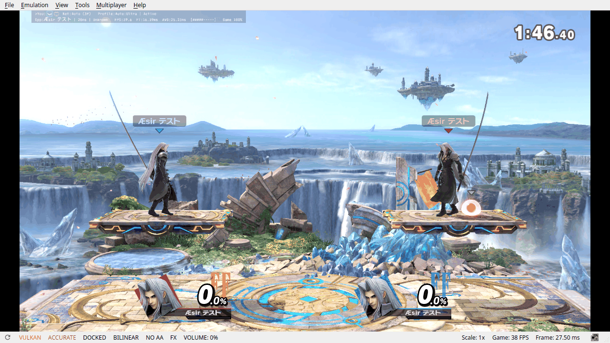

# Game speed (0.10.8)

The Settings strip in a networked battle shows “Game 100%”, or a lower
percentage when native elapsed match time advances more slowly than wall
time. A short hint describes sustained slowdown (“delay too low”) or an
observed freeze (“lag spikes”). Host or emulator slowdown can produce the
same readings; the hints do not identify a faulty peer or diagnose the network.

The readout covers Quickplay, Elite Smash, Arena and local-wireless battles.
It is absent in Training, waiting-room practice, offline play, character select,
countdown, GAME/KO, results and menus. It starts as “Game --” while collecting
the first second, or when current-object validation fails. Native banners are
unchanged. Eden LAN Online Quickplay supplied the paired timing evidence.
On 2026-11-18 the operator played online on their Switch with the release NRO
and reported no crashes or desync. Arena, Elite Smash, local wireless, the full
negative-control and long-string runtime matrices, and the explicit rematch-yes
route remain unverified.

The normal-time paired calibration selected these values:

- A one-second trailing window, updated at most 10 times per second.
- Below 97% continuously for two seconds selects “delay too low”.
  At least 99% for one second clears that hint.
- At least 100 ms without observed advancement selects “lag spikes” for two
  seconds, ahead of the sustained hint. There is no fast-window rate rule.

Steady 80% previously produced 94/94 false spike hints under the removed
250 ms/below-80% rule, despite a maximum observed flat interval of 41.9 ms.
The gap rule caught the 250/500 ms peer pauses (21/23 spike samples).
It did not catch the 100 ms pause: buffering left only 41 ms of observed flat
time. That outcome is expected. A frozen render cannot update the text until
rendering resumes; the next sample retains the full elapsed interval.

## Native source and lifecycle

The source is the current 13.0.5 match object's cumulative elapsed
accumulator at +0x3dc (timer helper +0xc), in 60 Hz units. Owning update
main+0x1572540 accumulates the native fractional rate and obeys native pause
state. This is native elapsed match time, not an unconditional engine-tick
serial or a presentation count. The old main+0x52e8b44 mirror of +0x3d8 stops
at the normal match limit and cannot measure advancing Sudden Death.

The signed, nonnegative 32-bit accumulator saturates at 21,599,999.
The constructor clears it; native phase initialization may preserve it or
set a nonzero origin. A decrease, saturation, missing eligibility, changed
object or new stage restarts or invalidates the estimate.

Each eligible draw resolves the current match service through the native
Hash40 registry rooted at main+0x52c3910. Checked, aligned, volatile reads
follow the native bucket walk, with cycle detection and no lookup retry.
The exact match vtable and type/getter slots are checked. A second fresh
resolution after the counter read must equal the first. No heap pointer is
cached between samples. The code never calls get_remaining_time, virtual
getters or the shared-reference path, and never changes reference counts.

Exact 64-byte pins guard the accumulator, constructor/reset, current lookup,
type/getter instructions and ReadyGo indirections. The original owner/copy/
ReadyGo checks remain. Every stage attempt starts a new generation before
validation; rejected stages, same-scene rematches, menus and CSS invalidate
old offers. Current native mode/melee words and ReadyGo must prove a networked
battle. Stored connection and latency-hook marks do not supply that proof.
The existing CSS invalidation hook must have installed.

Sampling runs inside the existing ui.rs::draw and UI try-lock, including
while hidden. GetSystemTick supplies 19,200,000 ticks/second; a fixed 16-point
ring measures native elapsed-frame delta divided by actual wall time and 60.
The display is rounded and bounded to 0–100; raw rates drive the hints.
There is no new hook, heap allocation, blocking lock, file I/O, game-memory
write or thread on this path. Registry traversal cost depends on the current
native bucket chain; the model's retained storage and scan are fixed.
The fact joins the existing timing segment.

## Counter evidence, 2026-11-15

Native source SHA-256:
8b3dc2eb011f26dda1f87947e4f62665e8d8fe3d84397e85ecf9b3cd9d0137ce.
Build ID:
21450c647b8c5940ed5b68218ea128fd3c5d597d000000000000000000000000.
Focused REA and exact instruction windows establish the owner, native rate,
enable state, reset sites and bounds. Native binaries stay outside this repo.

Retained paired samples show +0xc continuing beyond 7200 while the old mirror
holds 7200. During normal-time peer waits it stayed flat for at least
0.406626311 and 1.429811239 seconds, then resumed. Those old captures retained
an initial pointer and do not prove current-object lifetime or rematch reset.

The accepted replacement-source run retained same-batch positive native
Stop/Hit/Damage while +c advanced 1203→1219. The one-frame endpoint difference
from the 15 adjacent hitlag deltas is sequential-read skew, disclosed without a
tolerance. The primary waived the separate offline Training probe:
“primary-waived 01:2xZ: same-batch native hitlag evidence present”.

The later Sudden Death samples advanced +c 7203→8897 over 250 samples.
In that later interval +0x3d8 restarted at 3 and advanced to 1697; the earlier
saturated 7200 observation concerned the distinct main+0x52e8b44 mirror. Reviewed stills show Game 100%
on A and 98% on B without cause text. A fresh later normal match used a changed
object and restarted +c at 6. Evidence: external
`runtime-counter-fix-1/PARENT-SD-VISUAL-DIAG-REVIEW.json` and
`runtime-counter-fix-1/NATIVE-OBJECT-CONTEXT.json`. This proves an
observed new-match reset; an explicit rematch-yes route was not run.

SD stall: covered by the identical normal-time stall mechanism; not separately run (primary, 03:1xZ, proportional testing)

See [VALIDATION.md](VALIDATION.md) and [media provenance](MEDIA_PROVENANCE.md).
The new GIF uses three retained cuts at their actual capture cadence, showing
normal speed, the 92% peer throttle's delay hint, and recovery. Setup intervals
between cuts are omitted. Footage comes from Eden LAN Online Quickplay.

## Diagnostic trace

The diag variant alone records codes 122 and 123 at most 10 times per second
through the existing nonblocking recorder. They share the sampled SystemTick.
Code 122 retains this layout:

- a bits 0–31: validated cumulative elapsed frames (u32::MAX when invalid).
- a bits 32–39: displayed percentage (0xff during warmup or absence).
- a bits 40–41: cause (0=none, 1=delay, 2=spike).
- b: current eligible stage token (zero when ineligible).

Code 123 compares the source: a is the freshly validated match-object identity
(zero when invalid); b is its +0x3d8 normal-round elapsed timer (u32::MAX when
invalid). That comparison read and both sample events are absent from the
product build. Records describe sampled facts, not every intervening UI draw.
