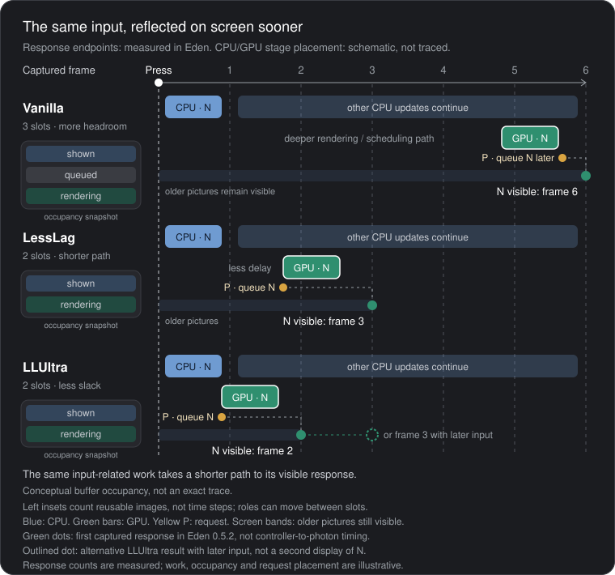

# How Deluxe LessLag and LLUltra work

## In Brief

Vanilla Smash prioritizes smooth performance by preparing and rendering frames ahead of time, keeping multiple images in circulation across three buffers. This gives the CPU and GPU breathing room, but also means frames can appear on screen later than necessary after you press a button.

**LessLag** reduces the buffers from three to two, changes which frame gets rendered, and eliminates unnecessary waiting, allowing newer frames to reach the screen sooner. Together, these changes reduce input delay by approximately **three frames**.

**LLUltra** pushes this further, potentially saving a fourth frame by using a more immediate rendering schedule, at the cost of giving the CPU and GPU less time to finish their work. Particularly demanding frames can exceed this tighter deadline, causing FPS drops. Overclocking or reducing rendering resolution can help recover the lost performance headroom.

Finally, **dispatcher backoff** reduces wasted CPU work from repeatedly checking for completed tasks, while **present-at-flush** requests presentation earlier, allowing the GPU to finish rendering while the CPU prepares subsequent frames. Together, these optimizations help maintain a smoother 60 FPS.

Illustrative, not a measured trace or a profile-specific schedule. Follow frame N: its presentation request can be queued while the GPU is still drawing it. The CPU can prepare N+1 at the same time. The display shows N at a later eligible refresh, once it is ready.

## Vanilla: headroom first

**Vanilla Smash** uses three buffers and a longer rendering pipeline. This gives the CPU and GPU more breathing room to prepare frames, but increases the delay before your inputs become visible.

A framebuffer is reusable memory; a frame is the picture drawn into it. The presentation queue tracks requests to display those pictures. More buffers allow more frames in circulation. Removing one buffer does not itself explain three saved frames: the measured reduction belongs to the combined buffer selection, rendering schedule and waiting changes.

## LessLag: a shorter pipeline

**LessLag** reduces this to two buffers, changes which frame gets rendered, and eliminates unnecessary waiting. Together, these changes shorten the pipeline, reducing input delay by approximately three frames.

## LLUltra: shorter still, less headroom

**LLUltra** pushes the pipeline further, potentially saving a fourth frame. However, this leaves less time for the CPU and GPU to finish their work. If they miss the display's deadline, FPS can drop and the additional latency advantage disappears.

Measured in Eden on 0.5.2 as captured images from an injected input to the first image showing the response. They are captured-response frames, not controller-to-photon timings. Full tables and clips: [Measured input delay](../README.md#measured-input-delay). Method: [Measuring frames removed by LessLag and LLUltra](LATENCY_METHODOLOGY.md).

At the same CPU simulation point N, the image labels N−2, N−1 and N illustrate the relative depth of TwoBehind, OneBehind and Immediate. These are conceptual content ages, not measured frame ages or fixed buffer identities. The implementation uses cyclic image selection; its offsets alone do not establish those ages.

Illustrative timings. In console Training captures on 0.5.2, expensive moves caused FPS drops in LLUltra while Vanilla and LessLag held their frame rate in those sessions. This is a scoped observation, not a guarantee for every scene or device. See [Implementation and timing tradeoffs](RENDERING.md#implementation-and-timing-tradeoffs).

### Following the same input

Start at Press and follow N, the picture carrying that input. The blue CPU bar updates the game in response to the press. The CPU then continues preparing later updates while the GPU works through drawing commands.

Follow the green GPU track next: dim bars represent other frames, and the bright bar draws N. Vanilla's deeper pipeline places this work later; LessLag and LLUltra bring it forward. The separate boxes count reusable image buffers, not time intervals; shown, queued and rendering roles can move between slots.

The yellow P marks the CPU's request to display N. Vanilla makes this request later, while LessLag and LLUltra request presentation at the flush, when the drawing commands are submitted. A request can be queued while the GPU is still drawing; it does not mean N is already visible.

Once N is ready, an eligible screen refresh can show it. The green dots mark the first captured response in Eden: frame 6 for Vanilla, 3 for LessLag and 2–3 for LLUltra; the outlined dot is an alternative result. Those counts are measured captured responses, not controller-to-photon timings. Work, request positions and buffer occupancy are illustrative, not an exact trace.

## Recovering smoothness

Finally, **dispatcher backoff and present-at-flush** reduce wasted CPU work and prevent late presentation requests, helping recover FPS consistency. Faster emulator hardware generally has more processing headroom, making these tighter deadlines easier to meet.

Dispatcher backoff briefly sleeps instead of repeatedly checking empty work queues; it runs in every profile, Vanilla included. Present-at-flush queues an image as soon as its final drawing commands are submitted, before the next CPU update. Submission does not mean the GPU has finished or the image is on screen. These additions support smoothness rather than independently explaining the original latency reduction; the captured-response counts were unchanged after present-at-flush.

See the diagrams under [Optimizations added by this rewrite](../README.md#optimizations-added-by-this-rewrite), [Dispatcher backoff](DISPATCHER_BACKOFF.md) and [Present at the flush](RENDERING.md#present-at-the-flush-040). Full profile behavior is in [Rendering profiles](RENDERING.md).
