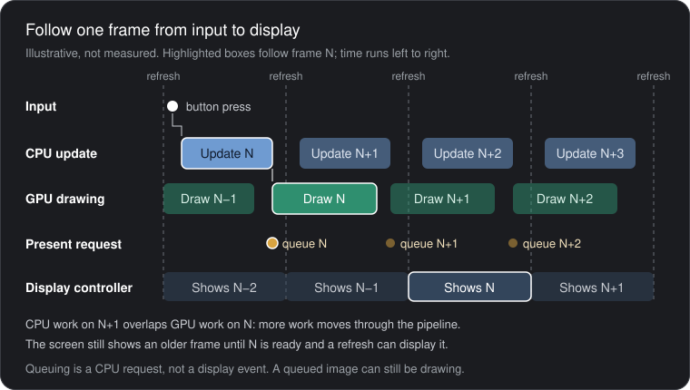
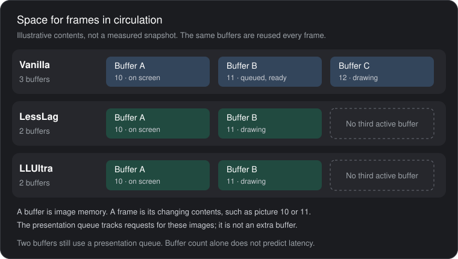
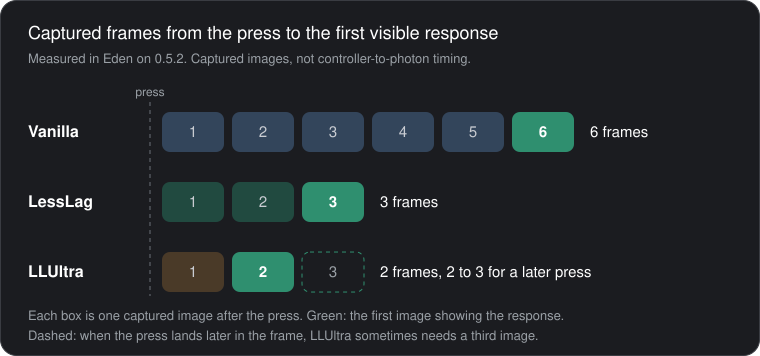
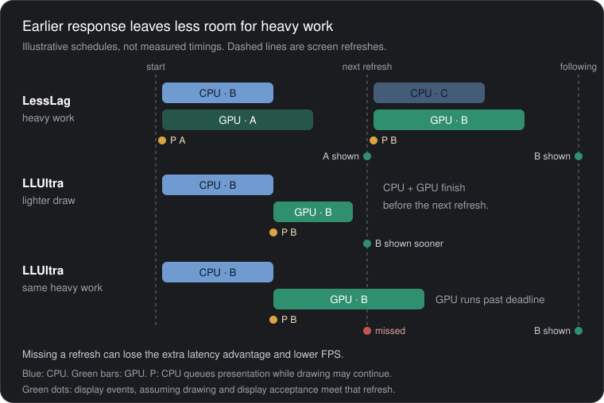

# How Deluxe LessLag and LLUltra work

When you press a button, Smash processes the input long before you see the result. The CPU must update the game, the GPU must render the image into a buffer, and the display system must show it.

Illustrative, not a measured trace. The CPU updates the next frame while the GPU is still drawing the current one, so the screen gets a new image at every refresh, but the image it shows was started some refreshes earlier.

## Vanilla: headroom first

**Vanilla Smash** uses three buffers and a longer rendering pipeline. This gives the CPU and GPU more breathing room to prepare frames, but increases the delay before your inputs become visible.

A third buffer lets a finished frame wait while another is drawn, so more frames are in circulation at once. The buffer count is one of several changes in LessLag. The three-frame figure below belongs to the whole profile, not to the missing buffer alone.

## LessLag: a shorter pipeline

**LessLag** reduces this to two buffers, changes which frame gets rendered, and eliminates unnecessary waiting. Together, these changes shorten the pipeline, reducing input delay by approximately three frames.

## LLUltra: shorter still, less headroom

**LLUltra** pushes the pipeline further, potentially saving a fourth frame. However, this leaves less time for the CPU and GPU to finish their work. If they miss the display's deadline, FPS can drop and the additional latency advantage disappears.

Measured in Eden on 0.5.2 as captured images from an injected input to the first image showing the response. They are captured-response frames, not controller-to-photon timings. Full tables and clips: [Measured input delay](../README.md#measured-input-delay). Method: [Measuring frames removed by LessLag and LLUltra](LATENCY_METHODOLOGY.md).

Illustrative. In console Training captures on 0.5.2, expensive moves made LLUltra miss refreshes while Vanilla and LessLag held their frame rate in those sessions. See [Implementation and timing tradeoffs](RENDERING.md#implementation-and-timing-tradeoffs).

## Recovering smoothness

Finally, **dispatcher backoff and present-at-flush** reduce wasted CPU work and prevent late presentation requests, helping recover FPS consistency. Faster emulator hardware generally has more processing headroom, making these tighter deadlines easier to meet.

Both are explained with diagrams under [Additional optimizations not yet present in Deluxe](../README.md#additional-optimizations-not-yet-present-in-deluxe), with details in [Dispatcher backoff](DISPATCHER_BACKOFF.md) and [Present at the flush](RENDERING.md#present-at-the-flush-040). They are separate from the changes behind LessLag's three-frame reduction: dispatcher backoff runs in every profile, Vanilla included, and the measured frame counts were the same before and after present-at-flush.
