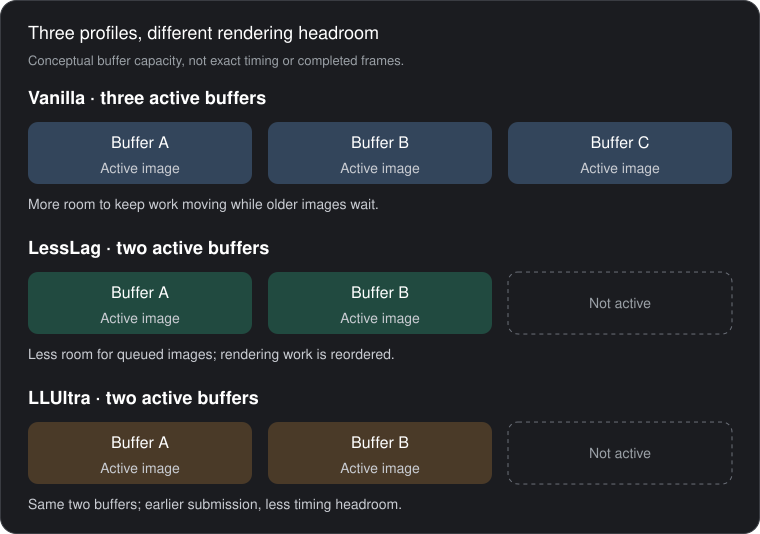

# How Deluxe LessLag and LLUltra work

LessLag and LLUltra aim to show more recent controller inputs at the game's
usual frame rate. They shorten the rendering pipeline without making the game
simulation itself run faster.

## Why does Smash buffer frames?

Smash normally uses three image buffers. This gives the CPU and GPU room to
prepare upcoming frames while other images are still waiting to be shown.
That overlap helps keep the game running smoothly, but it can also leave you
looking at an older picture of what is happening.

Think of buffers as space for work in progress: more space keeps production
moving, but also allows a larger backlog.

The boxes show capacity, not exact frame ages or hardware timing.

## How does LessLag reduce the delay?

LessLag uses two buffers and changes which image the game prepares for
display. It also moves some rendering work later in the frame and skips one
waiting step when safe. Together, these changes shorten the path from an
input to its visible response. GPU work still has to finish before an image
can be reused, so the CPU can still wait elsewhere.

Present-at-flush supports this shorter pipeline: it queues an image for
display as soon as its drawing commands are submitted, rather than waiting
through the next CPU update. The GPU may still be finishing the image;
requesting presentation and showing it are separate events.

## How does LLUltra go further?

LLUltra also uses two buffers, but selects a less delayed image and submits
graphics work earlier. That can shorten the response by another frame
compared with LessLag, as the Eden results below show.

## Why can LLUltra hurt performance?

That schedule leaves less room to overlap CPU and GPU work before the next
screen refresh. If a demanding scene takes too long, the image misses that
refresh and waits for another, lowering the frame rate.

This was observed in recorded console sessions: expensive moves caused drops
in LLUltra while LessLag maintained its frame rate. LessLag gives up some
potential latency reduction to preserve more timing headroom. The tradeoff
depends on the scene and load.

## What we measured in Eden

Recorded 0.5.2 benchmarks measured synthetic stick input to the first visible
crouch in captured images, with three trials per cell. The later phase
injected input about 8 ms later.

| Profile | Normal-phase response, frames | Later-phase response, frames |
| --- | --- | --- |
| Vanilla | 6 | 6 |
| LessLag | 3 | 3 |
| LLUltra | 2 | 2–3 |

LessLag's three-frame improvement belongs to the combined profile. Removing
one buffer does not automatically explain all three saved frames; these
experiments did not isolate each change's contribution. The counts are Eden
capture results, not Switch controller-to-screen timings.

For implementation, settings and console tradeoffs, see
[Rendering profiles](RENDERING.md). Full benchmark results and measurement
limits are in [Performance](PERFORMANCE.md#response-trials-re-measured-on-052-2026-10-15)
and the [measurement methodology](LATENCY_METHODOLOGY.md#re-measurement-on-052-present-at-flush-2026-10-15).
