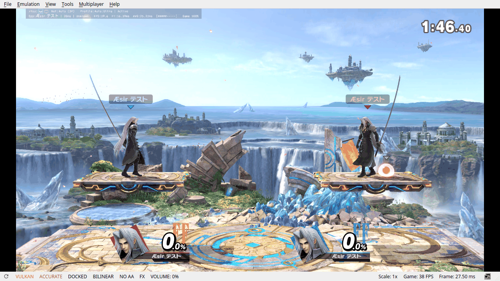

# Online Deluxe 0.10.8

Prepared 2026-11-16 UTC. **Eden (untested on hardware).**

The Settings match strip now shows **Game 100%** beside ping and buffer during
networked battles. When native elapsed match time advances more slowly than real
time, the percentage drops live. A one-second window keeps it readable.

- Sustained below 97% for two seconds: **delay too low**.
- No observed advancement for at least 100 ms: **lag spikes**, held for two seconds.
- At least 99% for one second clears the sustained hint; a spike takes priority.

These are timing hints, not a peer or network diagnosis. Host/emulator slowdown
can produce the same readings. The readout starts at **Game --** while warming
up or when native current-object validation fails. A frozen display updates when
rendering resumes.

Eligibility covers Quickplay, Elite Smash, Arena and local wireless. The fact is
absent in Training, waiting practice, offline play, CSS, countdown, GAME/KO and
results. It uses the current match object's cumulative elapsed accumulator, so
Sudden Death continues to measure advancing match time. Native banners are unchanged.

*2026-11-16 UTC; build 0.10.8-a4411607be20-1794789531 diagnostic observer;
Eden (untested on hardware). Three real-frame cuts: normal → peer 92% speed
limit → restored 100%; setup intervals omitted. Actual variable cadence,
27 frames / 7.46 s; no 10 fps capture claim.*

The new GIF/stills and match-strip trio replace only the affected online surface;
dated older menu captures remain explicitly historical. [Media provenance](MEDIA_PROVENANCE.md).

Validation includes paired normal/92%/80% calibration and recovery, native
hitlag, advancing Sudden Death, peer waits and a fresh later match.
The primary cancelled the redundant separate Sudden Death stall run because it
uses the identical normal-time stall mechanism. An explicit rematch-yes route
was not separately run; the observed new-match reset is retained.
Host gates passed 424 tests, zero clippy warnings, no-default-features and
production/diagnostic Skyline builds. NRO and header resident delta: **+4096 B**
over v0.10.7, with a **368 B** fixed speed model.

[Measurement and limitations](GAME_SPEED.md) · [Validation record](VALIDATION.md) ·
[Build and release](BUILD.md) · [Install](INSTALL.md)

Publication, tag and card installation remain held for primary review of the
complete package. The release build's manifest is authoritative for its commit,
build ID and hashes; the media identifies its runtime-tested source build.
