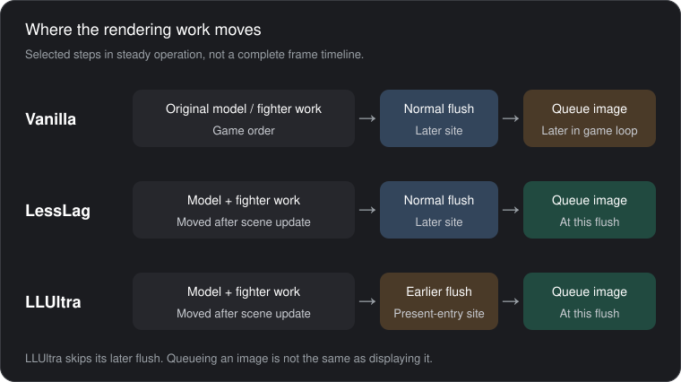

# Rendering profiles

**Auto is the default.** It uses Vanilla (Vanilla+ since 0.5.6, below) in menus,
offline matches and Training;
online singles use LessLag on console or LLUltra on emulator; online matches with
more than two fighters use LLDoubles. Local wireless counts as online here.

| Profile | Active textures | Presentation policy | Console resolution / DRS | Emulator resolution / DRS |
| --- | --- | --- | --- | --- |
| Vanilla | 3 | TwoBehind; with Vanilla+ (0.5.6, the default) it presents at the flush | 1080p / off | 1080p / off |
| LessLag | 2 | OneBehind, presents at the flush (0.4.0) | 1080p / on | 1080p / off |
| LLUltra | 2 | Immediate, earlier flush, presents at the flush (0.5.2) | 576p / on; `ultra_resolution=720` or `1080` raises the base. Unreleased menu labels: LLUltra+ / LLUltra++ ([below](#llultra-resolution-053-1080p-in-056)) | 1080p / off |
| LLDoubles | 3 | OneBehind, presents at the flush (0.5.2) | 1080p / on | 1080p / on |

For a conceptual introduction and the short Eden results table, see
[How Deluxe LessLag and LLUltra work](LESSLAG_LLULTRA.md).

## Implementation and timing tradeoffs

The following describes steady operation after the requested profile has been
confirmed. Transitions and safety guards can retain the game's original path.

| Part | Implementation | Code |
| --- | --- | --- |
| Active images | Vanilla uses three; LessLag and LLUltra use two. The count is applied through the window wrapper. | [`textures`](../src/config.rs#L64), [window setup](../src/runtime/nvn.rs#L152) |
| Image selection | Vanilla adds 2 before the game's existing `% 3`; LessLag uses `(index + 1) % 2`; LLUltra uses `index % 2`. Additions wrap as unsigned arithmetic. | [`index_value`](../src/render_policy.rs#L348) |
| Rendering wait | When the policy permits it, the wait hook returns `0` instead of calling the original function. | [wait hook](../src/runtime/renderer.rs#L116), [`skip_wait`](../src/render_policy.rs#L362) |
| Work ordering | Model updates and fighter command recording move after the scene update, followed by the deferred rendering queue's dispatch. | [post-scene work](../src/runtime/render_sequence.rs#L148) |
| LLUltra flush | The earlier present-entry hook flushes; steady operation suppresses the later flush. The flush plan calls the original function three times. | [early/late hooks](../src/runtime/render_ultra.rs#L27), [`plan_flush`](../src/render_policy.rs#L417) |
| Presentation | The flush hook queues the acquired image when allowed. The later request for the same image is skipped. | [flush hook](../src/runtime/renderer.rs#L219), [presentation wrapper](../src/runtime/nvn.rs#L372) |

These are cyclic image indices, not displayed frame numbers. `TwoBehind`,
`OneBehind` and `Immediate` are the project's relative index-policy names,
also used by the [crop-delay policy](../src/resolution.rs#L94). `Immediate`
does not promise immediate visibility or GPU completion.

This sketch omits other frame steps and waits. Image acquisition still calls
the original function, and the relocated fighter work keeps its worker wait.
The sequence hooks latch one decision per frame and keep the original ordering
while the teardown guard is active. The hook families are
[installed together after their checks](../src/runtime/renderer.rs#L265).

The [0.5.2 console move captures](VALIDATION.md) observed less overlap headroom
in LLUltra: CPU work and GPU completion had to fit before the same next
refresh, while LessLag could overlap more GPU work with the next CPU update.
Expensive moves exposed missed deadlines in LLUltra even at 576p while
LessLag held its frame rate at 1080p in those sessions. This is a scoped
observation, not a universal performance guarantee.

## How Auto knows it is online

The online context comes from the game's scene entries (main menu, Online →
Smash, background matchmaking, arena, local wireless, stage setup, character
select). Main-menu entry keeps a stored Quickplay, because background
matchmaking passes through the main menu and starts the match from there
(0.4.2). A Quickplay that reaches a Singles/Doubles stage without the game's
online-latency hook firing within five seconds is demoted to Offline. A match
the online-latency hook reaches while the scene hooks still say Offline counts
as online for Auto (0.4.1). Event log code 107 records both decisions; see
[Debugging](DEBUGGING.md).

## Present at the flush (0.4.0)

Two-image LessLag presents the acquired image at the end of the flush that
submits it and skips the game's later present of that index. The console trace
behind it: the game presented a frame only after running the next frame's whole
CPU update, 13.7 ms after submitting it, and in a two-image ring a present after
the vsync costs the next acquire a full vsync. On the console the
character-select hand sweep went from 49.9 fps with 20 % of frames over 20 ms
to 59.85 fps with 1.3 %; online matches run at 59.7–59.9 fps.
`renderer-status.txt` counts `early_presents`, `early_present_skips` and
`early_present_mismatches`; a mismatch is event log code 105. Evidence is in
[validation](VALIDATION.md) ("Present-at-flush candidate" and "Console
verdict and 0.4.0"). `early_present=false` in `config.ini` (0.5.3) switches
the early present off in every profile for a before/after against the game's
own order; see [Configuration](CONFIGURATION.md) and the clips under
[Optimizations added by this rewrite](../README.md#optimizations-added-by-this-rewrite).

## Vanilla+ (0.5.6)

Vanilla+ is the Vanilla profile with present at the flush on: the game's own
three-image swap chain, the acquire, the loop bookkeeping and the fighter
simulation are unchanged, but the acquired image is presented at the flush that
carried that frame's last submission, one CPU update earlier than the game
presents it. It is a flag, not a fifth profile, and **it is the default**: the
INI key `vanilla_plus` (`true` unless set otherwise; see
[Configuration](CONFIGURATION.md)) is on, `render_mode` defaults to `vanilla`
and `auto_profile` to `true`, so the shipped build is Vanilla+, and Auto's
Vanilla choice in menus, offline matches and Training is Vanilla+ too. The
NetProfile row, the in-match strip's `Profile:` field and the native CSS
banner's `You:` field read `Vanilla+` (manual), `Vanilla+*` (cleanup hold) and
`Auto:Van+` (Auto); with the flag off they read `Vanilla`, `Vanilla*` and
`Auto:Van`. **L+R+X** (neither ZL nor ZR held) toggles the flag live and saves
it ([Controls](CONTROLS.md)); `early_present=false` still disables every early
present, Vanilla+ included. The peer exchange still announces Vanilla, because
the ring shape is unchanged.

Why it should be safe, from the console API trace of 0.5.4 in Vanilla (Training
at 60 fps; `switch-mtp-055/logs-firstboot-1018/deluxe/api-3207722793418.csv` in
the evidence root): per loop iteration the trace shows PRESENT(idx), then
ACQUIRE(idx+1), then about 6 ms, then the single FLUSH span (the frame's last
submission, 4 µs after the late-flush marker), then about 9 ms of update, then
the next PRESENT of the index acquired at the previous loop head. So the
acquired image is already complete at the flush in the three-image shape too,
and presenting it there saves that update's 9 ms or so, about 9–13 ms of
display latency in the trace. The runtime presents `PENDING_INDEX`, the index
the loop-head acquire returned, and the game's own present of that index is
skipped through the existing early-present accounting (a mismatch is still
event code 105). The 0.5.2 LessLag traces (`api-2214438549910.csv`) show the
same index relationship for the early present.

This is code reasoning plus traces of the previous build. **No console run of
0.5.6 exists**; the owed checks (no tearing, stale frame or flicker in menus,
the character select and Training; 60 fps on the Performance page;
`early_presents` advancing in Vanilla with `early_present_mismatches=0`; the
L+R+X round trip; a subjective latency comparison with the chord off against
on) are in [validation](VALIDATION.md) ("0.5.6 — 2026-10-18: Vanilla+ (default), …").

## Dynamic resolution

DRS is dynamic resolution scaling during supported expensive visual events.
The resolution row reports the applied internal level, not just a requested
preset. Luigi's close-range Up-B cut-in lowered LLDoubles from 1080p to 720p
and restored it in Eden. Earlier, when Sephiroth's full-charge Gigaflare was
still a trigger, the console-policy Eden test had it lower LessLag and
LLDoubles from 1080p to 720p and LLUltra from 576p to 480p, then restore them,
with Vanilla keeping DRS off; those runs verified the policy and the restore
path, not Switch performance.

### LLUltra resolution (0.5.3, 1080p in 0.5.6)

Console LLUltra renders at 576p by default, the fork's choice. The INI key
`ultra_resolution` (`576`, `720` or `1080`; [Configuration](CONFIGURATION.md))
sets that base level, applied on the next present. In the unreleased compact
menu, the former UltraRes row is folded into **NetProfile** as LLUltra (576p),
LLUltra+ (720p) and LLUltra++ (1080p). ZR+Right raises the variant, then leaves
for LLDoubles after LLUltra++; ZR+Left lowers it, then leaves for LessLag after
LLUltra. Entering LLUltra recalls the saved level. Existing INI values and
renderer modes are unchanged ([Controls](CONTROLS.md)). `1080` is the game's
native level. Dynamic
resolution still steps down from the chosen base (1080p → 720p, 720p → 576p,
576p and below → 480p), so at 1080p the cut-in, move-table and adaptive
triggers are the only drops. Emulator profiles and the other console profiles
ignore the setting, and the peer exchange announces the configured level.

Why the option exists: the 2026-10-15 console captures put LLUltra's GPU time
at 3.4–5.3 ms at 576p inside the single vblank it shares with the CPU work, so
576p is what let it fit; nothing had measured 720p or 1080p. The operator
reports that with Horizon OC (2.6.0, installed 2026-10-16) **720p LLUltra held
a locked 60 on the console** (operator statement, 2026-10-18, no capture), so
the native level is offered for overclocked consoles. That is an uncaptured
observation, not a result of this build: **1080p LLUltra at 60 under the
overclock is the next cell to try**, with `CAPTURE_TIMING` in Training.
Captures taken under an overclock (`# clock=oc`) do not enter the move ledger.
The validation record holds no 720p or 1080p LLUltra capture, on a stock or an
overclocked console; the stock result stays the 576p one above.

### Per-move and adaptive triggers (0.5.2 experiment)

The shipped trigger is the fighter cut-in (the critical-hit and finish zoom,
held for a seven-frame cooldown). The original Online Deluxe also scales on
Sephiroth's full-charge Gigaflare; the rewrite carried that trigger until
2026-10-17 and dropped it because the console measurement did not justify it
(Vanilla and LessLag hold 60 through the move; see the move ledger in the
evidence root). Both paths are reached without smashline: a function hook on
the cut-in start and an inline hook on the fighter Main line that samples
entry, kind and status every tick for the move table. 0.5.2 adds two opt-in
triggers on the same report multiset, configured in `config.ini`
([Configuration](CONFIGURATION.md)):

- **Move table** (`drs_moves`): while a fighter's status is one of a named
  move's statuses, that entry holds one report at the next lower level
  (1080p → 720p, 720p → 576p, 576p and below → 480p, the fork's ladder) and
  releases it when the status leaves the move. Candidates came from the
  2026-10-15 FX campaign under a 120 % CPU quota in Eden and from the
  console: Pyra's side special dropped several frames when it connected,
  Falcon Punch about one.
- **Adaptive** (`drs_adaptive`): the present hook measures the interval
  between tracked presents; after `drs_adaptive_trigger_frames` consecutive
  intervals over `drs_adaptive_threshold_ms` it pushes one report, and after
  `drs_adaptive_release_frames` consecutive intervals within budget it pops
  it. Intervals of 200 ms or more (scene loads) reset the counters without
  counting. It covers work that no move name describes, such as a
  per-frame overlay plugin.

Neither trigger is a measured Switch improvement yet. Acceptance per move or
setting is a 30 s `CAPTURE_TIMING` on the console with the trigger on and
off, compared on intervals over 20 ms and on the `Resolution` row.

## Manual selection and the cleanup hold

Manual selection works during play and remains saved when Auto is selected.
The renderer reports **Active** only after its guarded transition has completed.
Match cleanup returns to Vanilla on the inactive scene (the banner and the
settings row read `Vanilla*`, or `Vanilla+*` with Vanilla+ on); the next match or an explicit selection applies
the saved manual mode again. Auto does not rewrite that saved mode.

The INI-only `lesslag_core` and `doubles_core` modes are component experiments,
require restart and are not substitutes for the full presets.

## FPS++

Upstream's separate **FPS++** option was implemented for investigation, but its
native path sped up the match clock in Eden, so the normal build only ever
reported it as **Unsupported**. It was removed on 2026-10-17: it was
emulator-only, never applied in normal play, and no console run reached it.
The INI key `fps_boost`, the Settings row, the Debug row, the chord, the
`ALLOW_FPS_BOOST` marker, event code 88 and the `fps_boost_status` /
`fps_boost_applied` lines of `renderer-status.txt` are gone; an existing
`fps_boost=` line is read and ignored. A peer's fork bit 14 is still decoded as
the `++` suffix on its announced profile. The measurements stay in the
[FPS++ investigation](FPS_BOOST_INVESTIGATION.md) as history. Hardware
overclocking remains excluded.

## Measured results

Build-specific acceptance is recorded in [STATUS](STATUS.md) and
[VALIDATION](VALIDATION.md). Tests have covered the global window plus native
status, standalone and embedded ImGui, Training Modpack, the corrected gamepad
overlay, Elite Legal Stages, persistent settings and linked play.

Earlier builds completed asymmetric LessLag/LLUltra matches and a real
four-fighter Auto/LLDoubles team match with the G&W fix on only one peer.
The newer peer-display build also joined three independent network stations
and exercised peer selection in the lobby. That run ended before a match;
it is not a three-station desync result.

A known emulator issue remains: concurrent instances under host load can hide
ImGui windows with manual LessLag/LLDoubles. Native text remains visible.
Removing the load can restore the windows. The cause is under investigation.

The following **24 response trials belong to `b19b7d94ae136e55`**; newer
display/effect builds do not inherit a new timing measurement, and the LessLag
render path changed in 0.4.0 (present at the flush) after these were taken, so
the LessLag row describes the earlier path. Each cell contains three trials at
the specified injection phase.

| Profile | Normal injection phase, three trials | Later injection phase, three trials |
| --- | --- | --- |
| Vanilla | 6, 6, 6 | 6, 6, 6 |
| LessLag | 3, 3, 3 | 3, 3, 3 |
| LLUltra | 2, 2, 2 | 3, 2, 3 |
| LLDoubles | 4, 4, 4 | 4, 4, 4 |

This supports reductions of 3 frames for LessLag, 3–4 for LLUltra and 2 for
LLDoubles in this captured-response experiment. LLDoubles was measured as a
manual profile in two-fighter Training; it is not a four-fighter timing result.
These are synthetic-input emulator screenshots, not Switch input-to-photon
measurements.

The [frame-measurement methodology](LATENCY_METHODOLOGY.md) defines input
submission, plugin input observation, captured response, phase controls,
consecutive-frame checks and exclusions. [Performance](PERFORMANCE.md)
retains the results; [validation](VALIDATION.md) records build-specific
compatibility and linked-match evidence.

Client-side rendering changes avoid gameplay/RNG modifications.
Matching linked-match results are evidence for those trials, not proof that
every online scenario is desync-free. NSO, console timing and four-console
coverage must be reported separately.
