# Screenshots

A short visual tour of the Deluxe window. Every image is a real capture from an
offline Eden session: most from the 0.7.0 session on 2026-10-24, with the separate
[FX Control](https://git.syntaxbyexample.com/intpa/ssbu-fx-control) companion
installed, and the ZR, privacy and Horizon-OC clips from a 0.8.1-candidate
session on 2026-10-27. Both used demonstration settings (manual LessLag,
`platform=emulator`, `vanilla_plus=false`), not the shipped defaults. Builds,
encoding and scope are in [Media provenance](MEDIA_PROVENANCE.md); every
control is in [Controls](CONTROLS.md).

## Open and cycle the window

The window has a few pages, and one chord steps through them.

1. Hold **L+R** and tap **D-pad Down** to open Settings.
2. Keep L+R held and tap Down again for each next page: Settings → FX Control →
   Stages → Performance → Window Options → hidden.
3. Debug is separate: **L+R+Plus** (or Minus) opens and hides it.

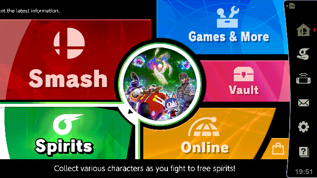

FX Control and Stages are pages of the companion plugin, not Deluxe; without a
plugin the cycle is Settings → Performance → Window Options → hidden.

## Change a setting

Values change only while **ZR** is held, so a stray D-pad press, a taunt or menu
navigation cannot change a setting.

1. On Settings, press **Down** to select NetLatency.
2. Hold **ZR** and press **Right**: Auto becomes `< 0 >`.
3. Hold **ZR** and press **Left** to restore Auto; **Up** returns to You.

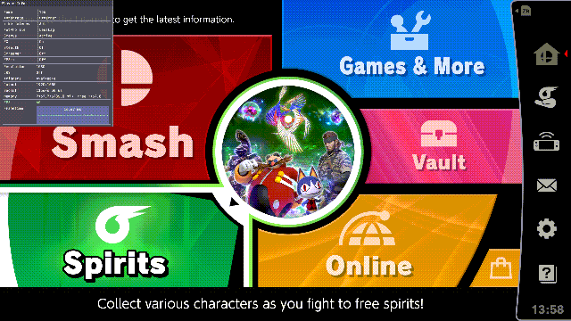

Inputs also reach the game: in this Training clip ZR shields and Up/Down taunt
behind the window. The grey clock after the privacy icons and `ZR+L3 OC` in the
hint line are there because the Horizon-OC stand-in is loaded (see below).

## Stealth and Streamer

The two privacy switches are icons on the You row.

1. Select **You**, the first Settings row.
2. **ZR+X** toggles Stealth: the eye closes.
3. **ZR+Y** toggles Streamer: the TV screen turns green. Press each again to
   turn it off.

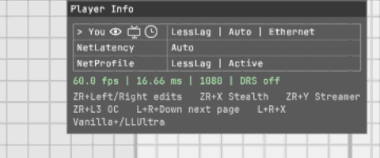

This offline clip shows the saved icon states only; it does not test network
suppression or reconnect behavior.

## Horizon-OC only when online

With the game-aware Horizon-OC fork, **ZR+L3** on Settings switches `hoc_oc`.
In `online` mode a clock follows the privacy icons; `always` removes it.

1. Hold **ZR** and press **L3**: the mode becomes always and the clock goes.
2. Press **ZR+L3** again: online mode, the clock returns. Grey means the saved
   profile is held back (offline here); green would mean it is applied.

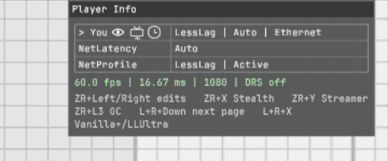

The Performance page's **Clock** row ends with the same state, wrapped to a
second line:

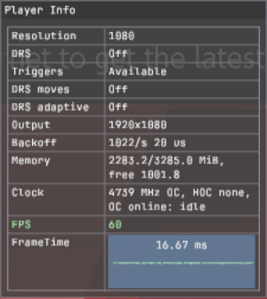

These are Eden captures with the test-only
[hoc-standin](../tools/hoc-standin/README.md) answering protocol v1 in place of
Horizon-OC: Deluxe's real client, gate and drawing, but no clock is changed and
the MHz figure is the emulator host's CPU, not a console. The green state needs
a connected player and is not shown.

## Edit a plugin page

A plugin NRO can add its own page, edited with the same ZR guard.

1. With FX Control installed, press **L+R+Down** from Settings to reach its page.
2. Select a fighter row (here Captain Falcon).
3. Hold **ZR** and tap **Right** for each step: On → Off → Reduced → On. The All row
   reads `Unavailable` while fighter settings differ.

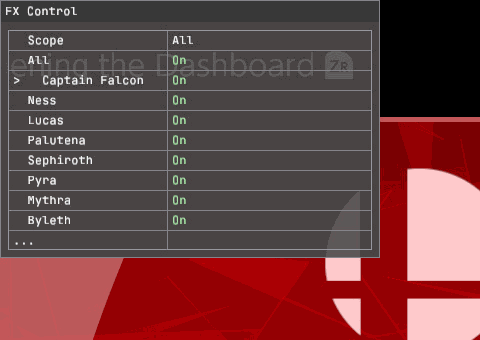

This shows the menu edits, not their gameplay effects. See [Plugins](PLUGINS.md).

## Training and matches

Training keeps the vertical window at the upper right. In an ordinary match,
Settings becomes a two-row strip at the top left: You with the privacy icons,
Net and Profile, then the live timing values and bar.

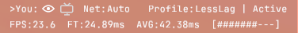

| | |
| --- | --- |
| 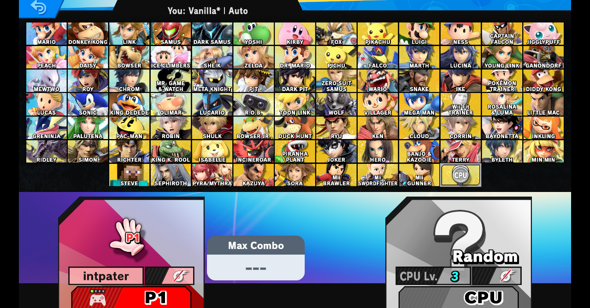   After Training the native status line reads `You: LessLag \| Auto`. | 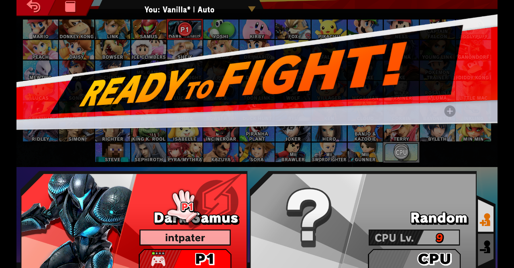   After quitting a match it reads `You: Vanilla* \| Auto`: the cleanup hold runs Vanilla for the saved manual LessLag. With the shipped `vanilla_plus=true` the label is `Vanilla+*`. |

With a live peer the strip's second line also carries the Opp summary; this
offline match has none.

## More screenshots

### Window pages

| | |
| --- | --- |
| 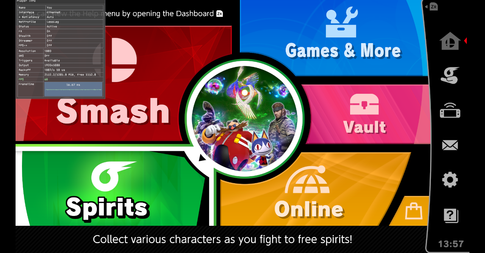   Settings: You, NetLatency, NetProfile, the performance footer and hints. No peer, so no Opp row. | 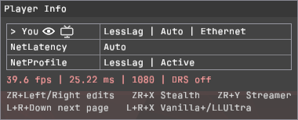   The selected You row with the eye and TV icons; Status is folded into NetProfile. |
| 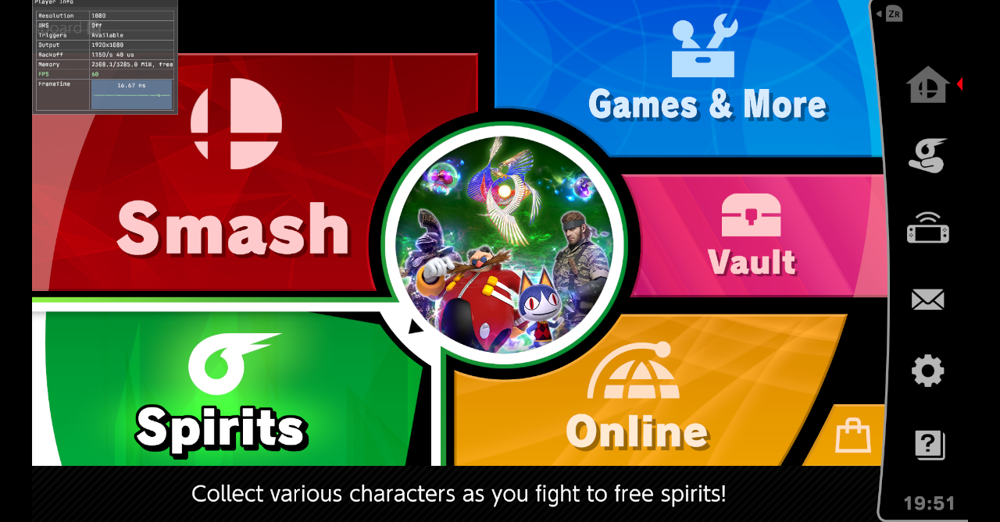   Performance: resolution, DRS, backoff, memory, clock and the frame-time plot. | 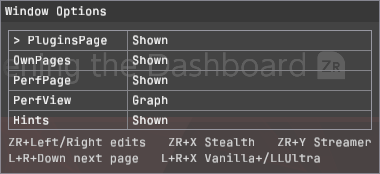   Window Options: page visibility, PerfView and Hints. |
| 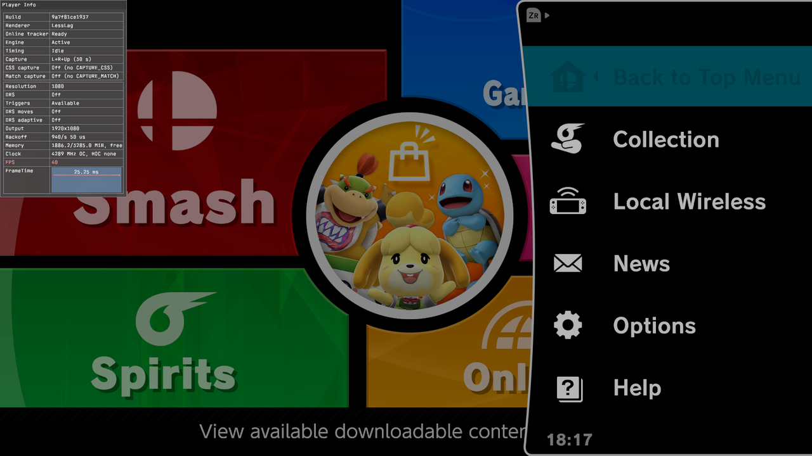   Debug on the main menu: build `9a7f81ce1937`, Timing Idle, capture flags off. | 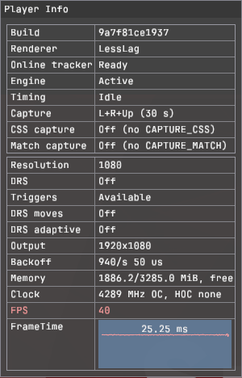   The same Debug table at source-pixel size. |
| 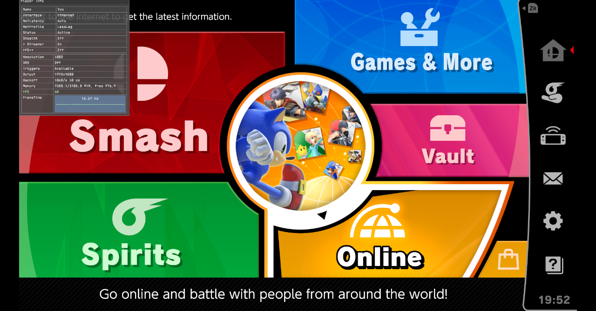   Streamer on (green TV); Stealth is also on in this intermediate frame. | 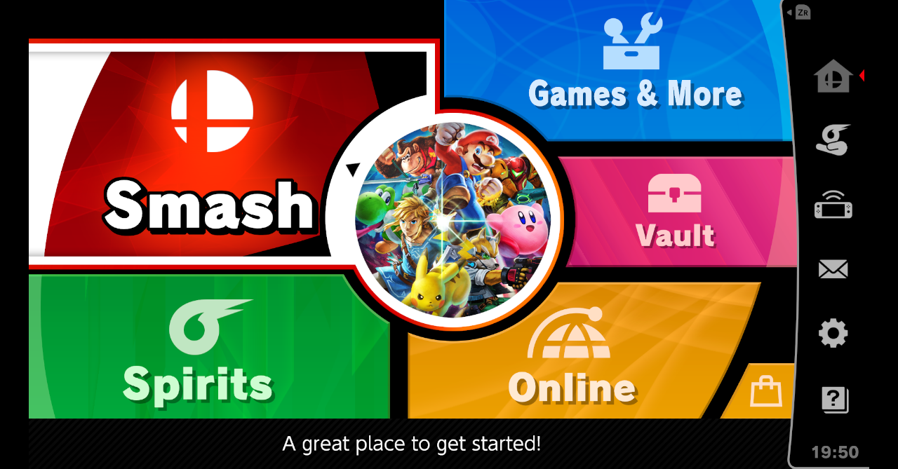   The main menu with the window hidden. |

### Companion pages

| | |
| --- | --- |
| 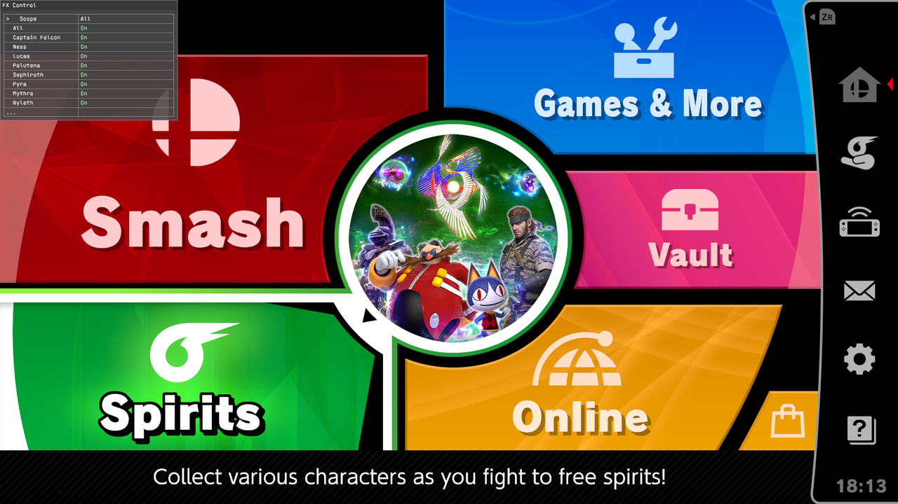   The companion's FX Control page follows Settings. | 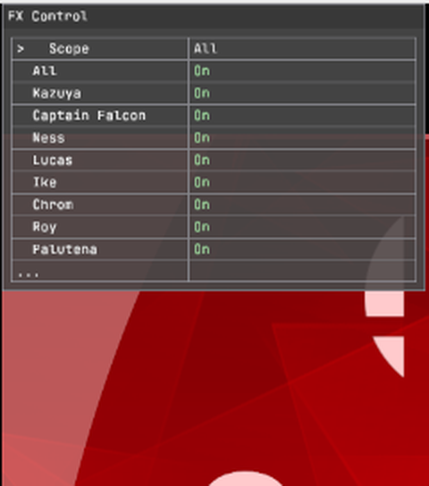   Scope, All and fighter rows; longer lists use `...` markers. |
| 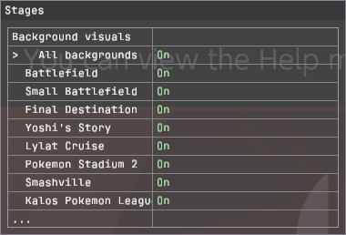   The companion's Stages page (background visuals). | |

### Training

| | |
| --- | --- |
| 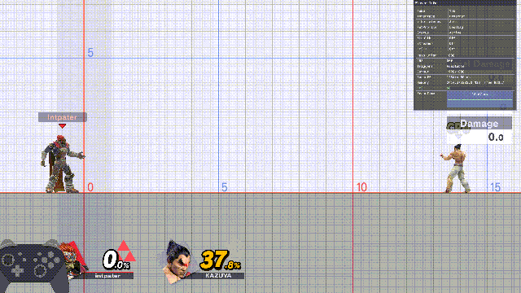   Six seconds of Training; the window stays vertical. | 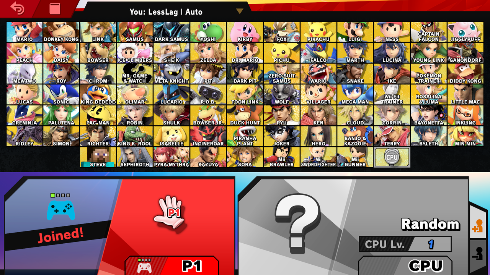   The next ordinary character select also reads `You: LessLag \| Auto`. |
| 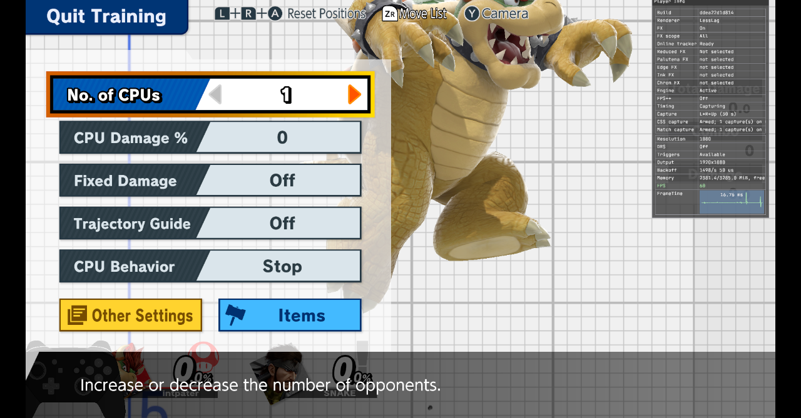   Debug in Training (Steve against CPU Kazuya) moves to the right. | 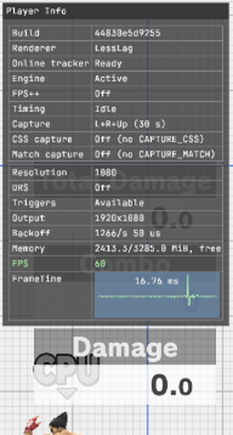   Source-pixel crop of that Debug window. |

### Match

| | |
| --- | --- |
| 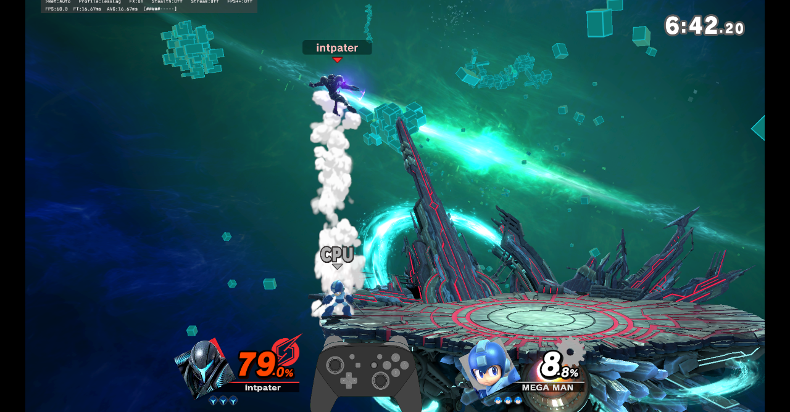   Pyra against a level-1 CPU Mario on Hollow Bastion: `>You:`, `Net:Auto`, `Profile:LessLag \| Active`. | 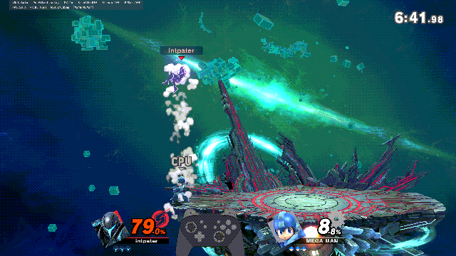   Six seconds with the Settings strip open. |
| 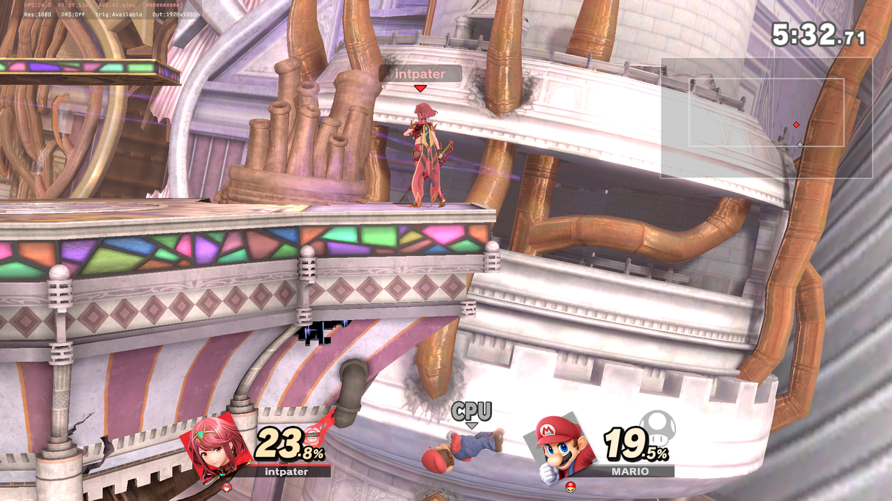   Performance uses the compact strip too. | 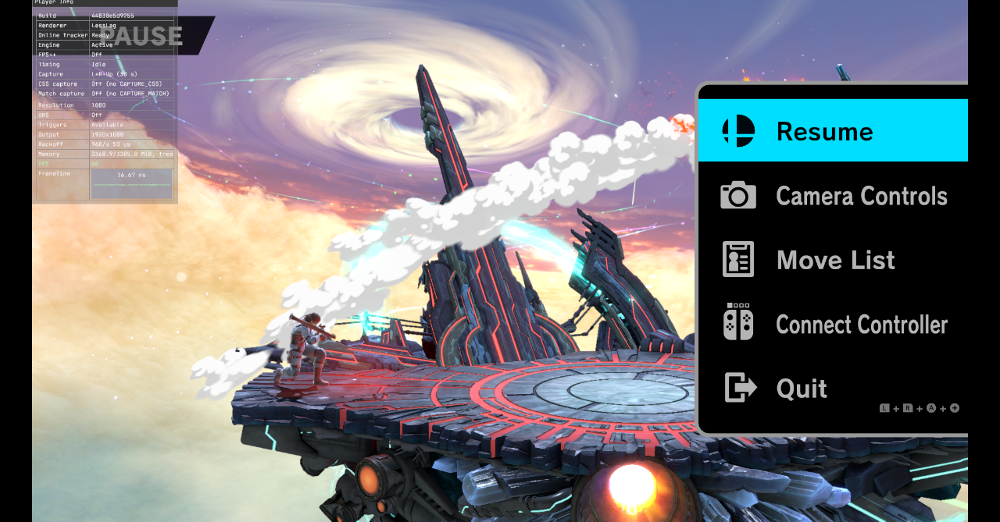   Debug stays a vertical table; L+R+Plus also opens the game's pause menu. |
| 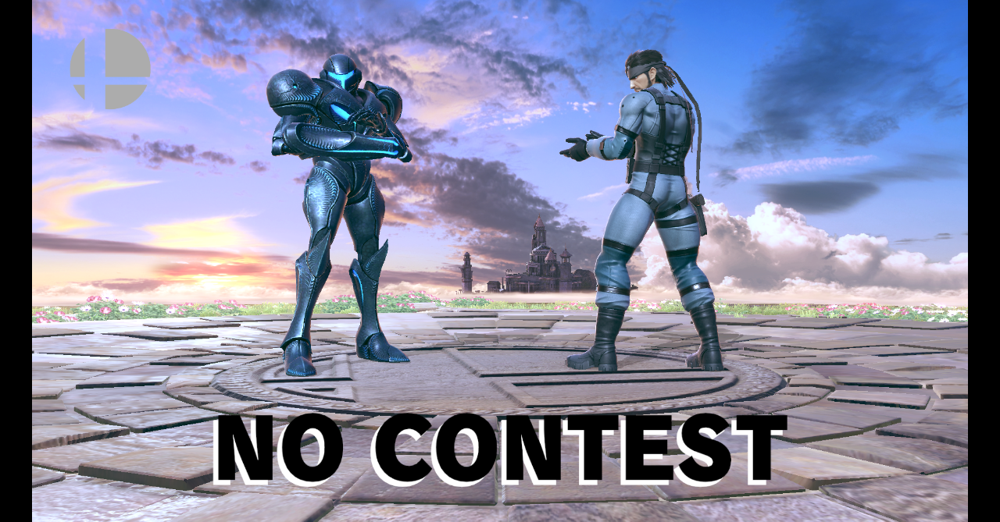   Results after Quit and Yes: No Contest, not a completed match. | |

Older measurement clips and diagrams keep their original scope; see
[Media provenance](MEDIA_PROVENANCE.md#historical-media-and-diagrams).
